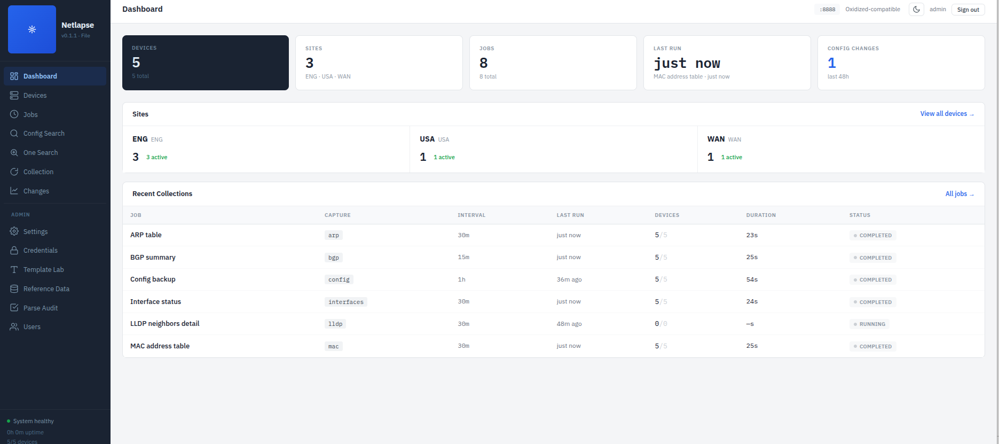
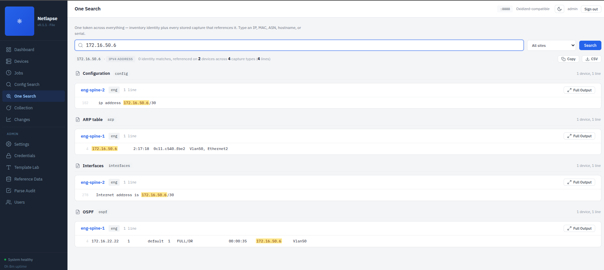
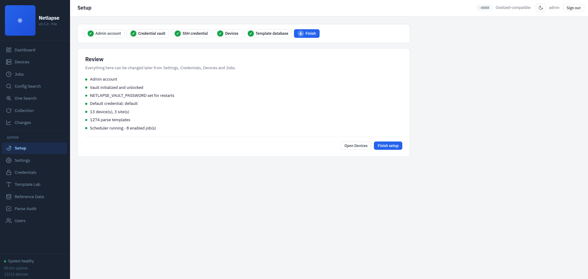

# Netlapse

An Oxidized replacment, network state time-lapse. Periodic structured snapshots of network device operational state with versioned diffs.




## New Capabilities in Development

**LibreNMS integration (beta).** Netlapse now serves an Oxidized-compatible REST
API, so LibreNMS renders Netlapse's configs, version history, and diffs under each
device's **Config** tab — and the **Refresh** button triggers an on-demand
re-collection. Validated end to end against a live LibreNMS instance.

<p align="center">
  
  
</p>

See **[Configuration Reference](https://github.com/scottpeterman/netlapse/blob/main/README_Config.md)** for wiring, authentication
modes, and the naming requirements that determine whether configs render.

## Why Netlapse?

Oxidized backs up configs as text blobs. It answers "what changed?" with `git diff`.

Netlapse captures *any CLI output* (configs, ARP tables, BGP state, routing tables, interface status), parses it into structured JSON, versions both artifacts, and answers "what changed?" with semantic diffs:

- **ARP diff**: "12 MACs learned, 3 aged out, 2 moved interfaces"
- **BGP diff**: "peer 10.0.0.1 went Established → Idle, prefix count dropped 4200 → 0"
- **Interface diff**: "Gi0/3 MTU changed 9000 → 1500"
- **Config diff**: same as Oxidized — git text diff. Table stakes.


## One Search

Type one token — an IP, a MAC, an ASN, a hostname, a serial — and get *everything* that references it across the whole fleet, grouped by what it means. It's the structured version of the 2 AM `grep`: instead of greping one device at a time, you ask the question once and the answer comes back organized.



A single search returns two answers:

- **Identity** — which managed device this token *is*. A management or OOB address, a hostname, a serial, an asset tag resolves to the device that owns it, with a link straight to its detail page.
- **References** — everywhere it's *seen*, grouped by capture type (config, ARP, MAC table, BGP, routes, version, …) then by device, with the matching lines highlighted. Open any hit to the full capture and copy it whole.

The matching is format-aware, because the value never appears the same way twice across a mixed fleet:

- **IP** is octet-anchored — searching `10.7.255.35` will not drag in `10.7.255.350` or `10.1.1.1`. The lines it returns are *actually* that address.
- **MAC** matches every vendor representation from one keystroke — type `d4af.f76c.45ad` and it also finds `d4:af:f7:6c:45:ad`, `d4-af-f7-6c-45-ad`, and the bare `d4aff76c45ad`, wherever they're stored.
- **ASN** matches with or without the `AS` prefix, so `AS64512` and `remote-as 64512` both surface.

Because it reads the captures Netlapse already stores, it has zero runtime coupling to collection — it's a query over the dual-artifact tree, not a second index to keep in sync. Trace a `/31` link subnet to the device that advertises it, pivot from its ARP entry to the chassis MAC in `show version`, and confirm they're the same box — in two searches, with no topology tool and no correlation database underneath.

## Semantic Diff

Two snapshots, one question that actually matters at 2 AM: did the network change, or did a timer just tick? Semantic diff answers it by comparing parsed records instead of raw text.
It matches each record by its identity — an ARP entry by IP, a BGP session by neighbor, an OSPF adjacency by neighbor ID — and reports only meaningful state changes: a MAC relearned on a different interface, a peer dropped to Idle, a route's next-hop moved. Volatile fields that tick every poll — age timers, uptimes, counters — are excluded by default, so the diff stays quiet when nothing operationally significant happened and surfaces the one line that matters when something did


Captures that have no record identity — running-config chief among them — fall through to the text diff. The semantic panel reports nothing to say, because a config has no keyed records to match on, and the unified text diff below it carries the answer:


### How a record's identity is chosen

Matching records by identity only works if the identity is right, and "the ARP table is keyed by IP" stops being true the moment a second vendor's template names that column something else. Netlapse resolves the key per capture type, per snapshot, against the data actually present.

Each capture type carries an ordered list of **candidate keys**, each of which may be composite — `["IP_ADDRESS"]`, then `["INTERFACE", "PROTO", "LOCAL"]`, and so on. Candidates are tried in order and validated against the records in hand: a candidate whose fields are not present on both sides is skipped, and a candidate that does not produce a unique value for every record is rejected. The first candidate that uniquely identifies every record wins, which means a wider composite is selected automatically when a narrower one collides — no per-vendor curation.

Uniqueness is the only disqualifier, and it is sufficient. A blank column collides on the second row that carries it; a part number reused across forty line cards collides forty times; a placeholder like `-` collides immediately. Rejecting fields for *looking* unusable was tried and removed — it cost roughly 1,600 snapshots their semantic diff to avoid a weakness that uniqueness already catches.

When no candidate survives, the diff **degrades loudly** to a whole-record hash comparison rather than silently keying on something wrong. Hash comparison preserves multiplicity, so duplicate records still count. `detect_key_collisions()` surfaces the same analysis in Parse Audit, and `tools/audit_keys.py` runs it across the real storage tree — resolved key, collisions, and document routing per capture type, exiting non-zero when something needs attention.

The alternative — a declared key map — was the original design and is what the audit tooling exists because of. A map says what the key *should* be; only the data says whether it *is*.

## Change Feed

Semantic diff answers "what changed on *this* device." The Change Feed answers
the aggregate: across the whole fleet in a time window, which devices and which
capture types actually moved — with volatility filtered out, so an ARP age timer
or a config commit-timestamp never reads as drift. It defaults to config (cheap,
high-value) and is filterable by capture type, site, and change kind
(`drift`/`new`/`gone`).

It's two-phase, because deciding realness means diffing: a cheap enumeration
lists candidate changes (a history walk, filenames only), then a batched verify
runs the semantic verdict on the drift candidates and streams the confirmed ones
in with a progress bar. Crucially, that verdict is computed the *same way* the
per-device Semantic Diff computes it, so the feed and the drill-in can never
disagree — and the **Dashboard's 48-hour config-change counter** reuses the exact
same pipeline, so the number on the dashboard always matches what you see when
you open the feed.

> **⚠️ Beta Version Notice**
>
> Netlapse is **beta**. It can run in production, but expect rough edges and breaking changes while the API settles.
>
> **Authentication.** Session-cookie login backed by scrypt-hashed local accounts, with optional LDAP/Active Directory. See [Authentication](#authentication). Adequate for an operator or a small team on a trusted network; not yet hardened for untrusted or multi-tenant exposure.
 
 
## Authentication

Netlapse authenticates against local accounts, a directory, or both. `auth.provider` selects the chain:

| Provider | Behavior |
|---|---|
| `local` | scrypt-hashed accounts in the application database |
| `ldap` | directory only |
| `ldap+local` | directory first, local accounts as break-glass fallback |


**The bind flow is service-bind → locate → proxy-bind.** A service account finds the user's DN, and the user's own credentials are then bound against the directory — the service account never validates a password. The supplied username is filter-escaped before it reaches the search filter, and an empty password is rejected before any network call, because a bind with a DN and an empty password is treated as an anonymous success by many directories. A directory that cannot be reached returns *directory unavailable* rather than *invalid credentials*, so an outage is distinguishable from a bad password in the logs.

**Transport is explicit.** `use_ssl` (LDAPS, TLS from the first byte) and `start_tls` (in-band upgrade on the cleartext port) are mutually exclusive and setting both is a startup error. A StartTLS negotiation that fails — refused, not offered, or a certificate that will not validate — fails the login rather than falling back to a cleartext bind. Setting neither is allowed and logs a warning, because unencrypted directory traffic should be a decision rather than an accident.

**Roles are directory-authoritative.** Group membership is re-evaluated on every login and mapped to a role, so editing a directory user's role in the UI does not stick. A local shadow row is provisioned on first successful login to give the user a stable identity in the application, but it carries an unusable random password and can never be logged into through the local provider. Disabling a user in the UI *is* durable — local disable wins over the directory, which makes it the fastest way to revoke someone.

**Mock mode** simulates the directory in memory, so the real login page can be exercised with no domain controller. Only the transport is simulated: the service bind, search, proxy bind, group gate, and shadow-row provisioning all run as they do in production. It logs a loud warning whenever it is active.

**Break-glass.** `NETLAPSE_ADMIN_PASSWORD` resets the *local* admin account, which only has a login path when a local provider is in the chain. Under pure `ldap` it cannot be used to get back in — startup logs a loud warning if the variable is set while LDAP-only. `ldap+local` keeps that door open by design.

Three behaviors are deliberate, tested, and worth knowing before deployment:

- **An empty `allowed_groups` is an open gate.** With no entries the group check is skipped and every user who binds is admitted at `default_role`. Set it explicitly outside a lab.
- **A bare group token matches the CN in any OU.** `netlapse-admins` matches that CN anywhere in the tree; use a full DN when two OUs can carry the same name.
- **Group membership is direct only.** `memberOf` is not transitive in Active Directory, so a user in a group that is itself a member of an admin group reads as not a member and receives `default_role`.

Full key reference in [README_Config.md](https://github.com/scottpeterman/netlapse/blob/main/README_Config.md#auth--authentication-and-authorization).

## Data-Driven Collection

What Netlapse collects — and how each vendor's CLI says it — is defined in two YAML files, not in code. They live as siblings of `config.yaml` (default `~/.netlapse/`):

**`captures.yaml`** — the catalog of collectable artifacts. Each capture is a vendor-neutral intent (an ARP table, a BGP summary) plus the syntax to get it. `command` is either one string for everyone, or a map keyed by platform slug with a reserved `default` fallback:

```yaml
captures:
  bgp-summary:
    capture_type: bgp
    description: BGP session state
    command:
      default: show ip bgp summary
      juniper_junos: show bgp summary
    interval: 900
```

**`jobs.yaml`** — bindings: which capture runs against which devices. A binding carries no command syntax and no interval (those come from the capture it references) — only the device selection:

```yaml
jobs:
  bgp-summary:
    capture: bgp-summary
    name: BGP summary
    enabled: true
    filters:
      platform: cisco_ios,arista_eos,juniper_junos
```

Adding a vendor, a capture, or a whole new artifact type is a file edit and a restart — no coder in the loop:

```bash
# edit ~/.netlapse/captures.yaml + jobs.yaml, then:
python -m netlapse definitions validate    # offline, all-or-nothing check
python -m netlapse definitions sync         # project into the jobs table (or just restart)
```

The new capture type then propagates to the UI through the DB — it appears in the Capture Type selector on every job, with no template or schema work.

**Files are authoritative for definitions; the DB owns runtime state.** A sync reconciles the jobs table to the files — insert new, update changed, tombstone removed — but never touches the live enable/disable toggle, the schedule, or job history. Validation runs over the whole catalog at once and is fail-soft: a typo is reported alongside every other problem in one pass, and the sync is skipped entirely rather than half-applied — the daemon keeps running on the last-good definitions already in the DB.

The `definitions` CLI rounds it out: `validate`, `sync`, `list`, and `adopt` (which takes over jobs that predate the registry). See [Design Decisions](https://github.com/scottpeterman/netlapse/blob/main/README.md#design-decisions) for why definitions are file-authoritative while platforms stayed in the DB.

## Project Status

**Structured parsing operational via tfsm-fire. Multi-vendor job management with per-platform command mapping, device-level CRUD with credential and SSH override controls, and integrated SSH auth diagnostics. Collecting on schedule against the NetEmulate test fleet, with live WebSocket progress.**

| Layer | Module | Lines | Status |
|---|---|---|---|
| **API** | Oxidized compat (12 routes) | 333 | ✅ Wired to DCIM + storage + scheduler |
| **API** | Native REST (31 routes) | 875 | ✅ Full CRUD + device edit + auth test + scheduler triggers + search |
| **API** | Admin (17 routes) | 787 | ✅ Users, settings, credentials, template management |
| **API** | Change feed + parse audit (4 routes) | 567 | ✅ Fleet drift enumeration, per-device parse trust scoring |
| **Auth** | Local + LDAP/AD providers, sessions | 1,745 | ✅ scrypt, directory-authoritative roles, mock mode, 66 tests |
| **DCIM** | NetBox-aligned SQLite schema (v10) | 2,437 | ✅ Jobs, devices, history, CRUD, per-platform commands, auto-migration |
| **DCIM** | SC2 map importer | 1,059 | ✅ Topology → DCIM sync, idempotent, full hostname preservation |
| **Registry** | Definition catalog + volatility policy | 1,310 | ✅ File-authoritative captures/jobs, fail-soft validation, shared resolver |
| **Storage** | File backend (directory tree) | 934 | ✅ Dual artifacts (raw + parsed JSON), last-N rotation |
| **Storage** | Git backend (versioned + trailers) | 836 | ✅ Tested |
| **Storage** | Record diff engine | 668 | ✅ Data-validated composite keys, collision detection, hash fallback |
| **SSH** | Client (Paramiko wrapper) | 1,109 | ✅ Ported from SC2, key auth, legacy algorithm + pubkey signature handling |
| **SSH** | Emulation shim (NetEmulate) | 302 | ✅ Verified against the NetEmulate test fleet |
| **SSH** | Executor (DCIM → SSH → Snapshot) | 766 | ✅ Built, auth test, device-level legacy override |
| **Vault** | Credential vault (Fernet/PBKDF2) | 2,782 | ✅ Ported from SC2, headless unlock, key + password auth |
| **Vault** | DCIM bridge + credential resolution | 488 | ✅ Vault ↔ executor integration |
| **Core** | Collection pipeline (DCIM→vault→SSH→disk) | 606 | ✅ End-to-end proven, \r\n normalization |
| **Core** | CLI (sync-map, vault, collect, definitions) | 330 | ✅ Subcommand dispatch |
| **Parser** | tfsm-fire engine (TextFSM auto-template) | 334 | ✅ Ported from SC2.5, thread-safe |
| **Parser** | Parse engine (clean + score + enrich) | 420 | ✅ Output cleaning, filter cascade, vendor fallback |
| **Parser** | Template database | 1,274 templates | ✅ Cisco (264), Arista (45), Huawei (41), MikroTik (36), HP (30), Brocade (23), Juniper (19), Fortinet (17), others |
| **Scheduler** | Async job loop + WS broadcast + parsing | 814 | ✅ Exercised against the NetEmulate test fleet, inline tfsm-fire, per-platform command resolution |
| **Web** | Dashboard (FastAPI + vanilla JS) | 7,245 | ✅ Live — 14 views, job CRUD, device edit + auth test, parsed data tables, capture type selector |
| **Tests** | pytest suite | 2,562 | ✅ 318 tests — diff engine, auth, token matching, volatility, LDAP fixture |
| **Tools** | Key audit + LDAP test server | 1,526 | ✅ Real-data key audit, stdlib LDAP server for auth testing |

```
netlapse/
├── __init__.py              (3)     Package version
├── __main__.py              (330)   CLI: serve, sync-map, vault, collect, definitions, snapshot, cleanup, fetch-templates
├── app.py                   (624)   FastAPI app, lifespan, vault unlock, parser init, scheduler start, auth wiring
├── config_template.py       (206)   Documented starter config.yaml
├── parse_test.py            (304)   Single-device collect + parse diagnostic tool
├── api/
│   ├── native.py            (875)   31 native REST routes at /api/v1/
│   ├── admin.py             (787)   17 admin routes — users, settings, credentials, templates
│   ├── parse_audit.py       (389)   Per-device parse trust scoring + key collision reporting
│   ├── oxidized_compat.py   (333)   12 Oxidized-compatible routes at /
│   ├── changes.py           (178)   Fleet change enumeration + batched semantic verify
│   └── dcim_admin.py        (153)   Site/platform/role administration
├── auth/
│   ├── web.py               (599)   Login routes, session cookie, tier evaluation
│   ├── providers.py         (522)   Local (scrypt) + LDAP/AD providers, mock directory
│   ├── store.py             (293)   app_users + sessions, shadow-row provisioning
│   ├── manager.py           (230)   Provider chain, session lifecycle, break-glass guard
│   └── hashing.py           (78)    scrypt hashing, verification, rehash-on-login
├── core/
│   └── collector.py         (606)   End-to-end collection pipeline, \r\n normalization
├── dcim/
│   ├── db_schema.py         (2437)  SQLite schema v10, views, queries, CRUD, auto-migration
│   ├── map_importer.py      (1059)  SC2 topology map → DCIM sync, hostname.site preservation
│   └── dbrepair.py          (263)   Schema repair utilities
├── registry/
│   ├── volatility.py        (385)   Diff-time noise policy — volatile fields and config lines
│   ├── loader.py            (255)   captures.yaml / jobs.yaml parsing + fail-soft validation
│   ├── sync.py              (190)   Catalog → jobs table reconciliation, tombstoning, adoption
│   ├── cli.py               (175)   definitions validate / sync / list / adopt
│   ├── models.py            (103)   Capture and binding dataclasses
│   ├── service.py           (90)    Registry service facade
│   └── resolver.py          (58)    Shared per-platform command resolution
├── parser/
│   ├── engine.py            (420)   ParseEngine — output cleaning, filter cascade, vendor fallback
│   └── tfsm_fire.py         (334)   TextFSMAutoEngine — template matching + scoring
├── scheduler/
│   └── __init__.py          (814)   ConnectionManager + Scheduler (poll loop, queue, WS broadcast, inline parsing)
├── storage/
│   ├── file_backend.py      (934)   Directory tree, last-N rotation, multi-type search, parsed JSON write-through
│   ├── git_backend.py       (836)   Git versioning, commit trailers, structured diffs
│   ├── diff.py              (668)   Record identity resolution, semantic diff, collision detection
│   ├── backend.py           (647)   Abstract interface + Snapshot/DiffResult
│   ├── cleanup.py           (587)   Retention enforcement and pruning
│   ├── config_diff.py       (273)   Text diff path for document captures
│   ├── token_match.py       (145)   Format-aware IP/MAC/ASN matching for One Search
│   └── health.py            (125)   Storage health reporting
├── ssh/
│   ├── client.py            (1109)  SSHClient with DCIM platform field mapping, legacy pubkey handling
│   ├── executor.py          (766)   v_device_detail → SSHClient → Snapshot[], auth test with debug capture
│   ├── proxy.py             (382)   Jump-host / proxy support
│   └── emulation.py         (302)   NetEmulate shim (standalone, reusable)
├── vault/
│   ├── vault.py             (1059)  CredentialVault — CRUD, encrypt/decrypt
│   ├── bridge.py            (488)   Headless unlock, DCIM↔vault integration
│   ├── schema.py            (411)   Vault SQLite schema + DatabaseManager
│   ├── models.py            (391)   SSH/SNMP credential dataclasses
│   └── encryption.py        (339)   PBKDF2 key derivation + Fernet encryption
└── web/
    ├── __init__.py          (39)    Web router — serves / and mounts /static
    └── static/
        ├── index.html       (121)   SPA shell: sidebar, content area, module loader
        ├── css/             (3917)  Light + dark themes, admin styles, component library
        └── js/              (7245)  Hash router, API client, WS manager, 14 view modules

tests/                       (2562)  318 tests
├── test_diff.py             (691)   76 — record identity, collisions, hash fallback, volatility exclusion
├── test_auth_providers.py   (523)   58 — local + LDAP providers, group gate, shadow rows, filter escaping
├── test_ldapd.py            (492)   36 — the LDAP fixture itself, and the client behaviors it pins
├── test_volatility.py       (452)   52 — field and config-line noise policy
├── test_token_match.py      (255)   88 — IP/MAC/ASN format-aware matching
└── test_auth_starttls.py    (149)   8  — StartTLS negotiation and fail-closed behavior

tools/                       (1526)
├── ldapd.py                 (1290)  Stdlib LDAP server for auth testing — hand-rolled BER, fault injection, LDAPS + StartTLS
└── audit_keys.py            (236)   Walks the real storage tree, reports resolved keys and collisions per capture type
```

## Quick Start

```bash
pip install netlapse
```

### First-run setup (web)

Start the daemon on a fresh install and browse to `http://127.0.0.1:8888/setup`.
A six-step wizard covers admin account, credential vault, SSH credential, device
import, template database and review. The first visitor becomes admin, so run it
before the port is reachable by anyone else. Walkthrough with screenshots:
[README_Getting_Started.md](README_Getting_Started.md#fast-path-the-setup-wizard).



The rest of this section is the equivalent CLI path.

### Import devices from Secure Cartography topology map

```bash
# Dry run — parse and report, no writes
python -m netlapse sync-map /path/to/map.json --dry-run

# Import — creates sites, assigns roles, detects platforms
python -m netlapse sync-map /path/to/map.json

# Exclude OOB management switches
python -m netlapse sync-map /path/to/map.json --exclude-prefix oob
```

The map importer supports two hostname conventions:

| Convention | Example                    | Device Name     | Site    |
|---|----------------------------|-----------------|---------|
| Dot-separated (datacenter/SP) | `border01.site1.company.com` | `border01.site1` | `site1` |
| Dot-separated (datacenter/SP) | `peer1-01.site1`            | `peer1-01.site` | `site1` |
| Dash-prefixed (campus/enterprise) | `den-core-01`           | `den-core-01`   | `den`   |

Device names preserve the operational hostname — domain suffixes are stripped but the site segment stays because it's part of the device identity (`border01.site1` and `border01.den2` are different devices).

Roles are inferred from hostname patterns (`border*` → router, `tor*` → leaf, `-core-` → core, `-sw-` → access). Platforms are parsed from SC2's discovery strings (`Arista DCS-7280SRA-48C6-F EOS 4.33.1.1F` → `arista_eos`, `Cisco IOS-XE 17.03.06` → `cisco_ios_xe`, `Juniper JUNOS 23.2R1-S2.5` → `juniper_junos`). Handles both short (`Arista EOS 4.33.1.1F`) and full chassis (`Arista DCS-7280SRA-48C6-F EOS 4.33.1.1F`) platform strings. Idempotent — safe to re-run after every SC2 discovery cycle.

### Initialize credential vault and collect

```bash
# Initialize vault with master password
python -m netlapse vault init

# Add SSH credentials (password auth)
python -m netlapse vault add-ssh lab -u admin -p admin --default

# Add SSH credentials (key auth)
python -m netlapse vault add-ssh prod -u scott -k ~/.ssh/id_ed25519 --default

# Add SSH credentials (key + password for enable)
python -m netlapse vault add-ssh prod -u scott -k ~/.ssh/id_rsa -p 'enable_pass' --default

# Assign credential to all devices
python -m netlapse vault assign prod

# Verify
python -m netlapse vault list

# Delete a credential
python -m netlapse vault delete lab

# Collect configs (one-shot CLI)
export NETLAPSE_VAULT_PASSWORD="your_master_password"
python -m netlapse collect --site den

# Collect against NetEmulate (emulated devices)
python -m netlapse collect --site den --emulate

# Run a named job
python -m netlapse collect --job config-backup

# Start the daemon (scheduler + API + Web UI)
python -m netlapse
```

The vault stores key file contents encrypted — the original file isn't referenced at runtime, so the daemon doesn't need filesystem access to the key.

Browse the Web UI at `http://localhost:8888` or the Swagger API docs at `http://localhost:8888/docs`.

### First scheduled collection (against NetEmulate)

```
$ python -m netlapse
Netlapse starting
Storage backend: FileBackend at /home/user/.netlapse/data
Emulation enabled: device IPs loaded from ip_lookup.json
Vault unlocked from NETLAPSE_VAULT_PASSWORD env var
Scheduler started (poll=15s, workers=2)
Netlapse ready — http://0.0.0.0:8888

Job 'config-backup': collecting from the emulated fleet (trigger=scheduled, history=1)
  den-core-01: show running-config — 35361 bytes in 0.1s
  den-core-02: show running-config — 33057 bytes in 0.1s
  den-2-sw-01: show running-config — 47442 bytes in 0.1s
  ...
Job 'config-backup' complete (history=1)
```

## Architecture

```
┌─────────────────────────────────────────────────────┐
│  FastAPI Application (port 8888)                    │
│  ├── /nodes, /node/* → Oxidized compat API          │
│  ├── /api/v1/*       → Native Netlapse API          │
│  ├── /ws             → WebSocket (live progress)    │
│  └── /               → Web UI (vanilla JS)          │
└────────────────────┬────────────────────────────────┘
                     │
┌────────────────────▼────────────────────────────────┐
│  Scheduler (asyncio + ThreadPoolExecutor)            │
│  ├── Poll loop: get_due_jobs() every 15s             │
│  ├── Job queue: scheduled + API triggers             │
│  ├── Worker threads: collect_device() per device     │
│  ├── WS broadcast: per-device progress to all clients│
│  └── History: job_history + job_device_results       │
└────────────────────┬────────────────────────────────┘
                     │
┌────────────────────▼────────────────────────────────┐
│  Collection Engine                                   │
│  ├── Collector (DCIM → vault → executor → storage)   │
│  ├── SSH Client (Paramiko, legacy device support)    │
│  ├── Emulation shim (NetEmulate mock devices)        │
│  ├── Parse engine (tfsm-fire, 1,274 templates)       │
│  └── Credential vault (Fernet/PBKDF2 encrypted)     │
└────────────────────┬────────────────────────────────┘
                     │
┌────────────────────▼────────────────────────────────┐
│  Storage Layer                                       │
│  ├── Git backend (raw text + parsed JSON per commit) │
│  ├── File backend (directory tree, last-N rotation)  │
│  ├── DCIM SQLite (devices, jobs, history)             │
│  └── Vault SQLite (encrypted credentials, separate)  │
└─────────────────────────────────────────────────────┘
```

### Scheduler Data Flow

```
app.py lifespan → DB → Storage → Vault unlock → Parser init → Emulation → Scheduler.start()
                                                                │
    ┌───────────────────────────────────────────────────────────┘
    │
    ├── Poll loop (asyncio, main thread)
    │   └── get_due_jobs(now) → queue.put(("scheduled", slug))
    │
    ├── API triggers (async, main thread)
    │   ├── POST /api/v1/jobs/{slug}/run   → scheduler.enqueue_job()
    │   ├── POST /api/v1/collect/{id}      → scheduler.enqueue_device()
    │   └── GET/PUT /node/next/{node}      → scheduler.enqueue_device()
    │
    └── Queue consumer → ThreadPoolExecutor (worker thread)
        ├── NetlapseDB(db_path)             # thread-local DB connection
        ├── db.start_job_run()              # job_history row (status=running)
        ├── for device in targets:
        │   ├── collect_device()            # SSH → Paramiko → raw output
        │   ├── parser.enrich_snapshot()    # tfsm-fire → parsed records + score
        │   ├── _record_result()            # store snapshot + update device status
        │   ├── db.insert_device_result()   # per-device history row
        │   └── _broadcast()                # WS events → collection view
        ├── db.complete_job_run()           # finalize counts + status
        └── db.update_job_schedule()        # next_run = now + interval
```

### End-to-End Data Flow

```
CLI: netlapse collect --site den --emulate
    │
    ▼
Map importer: SC2 map.json → DCIM (sites, platforms, roles, devices)
    │   Hostname parsing: border01.site1 → site=site1, den-core-01 → site=cal
    │   Platform parsing: "Cisco IOS-XE 17.03.06" → cisco_ios_xe
    │   Role inference: border* → router, tor* → leaf, -core- → core
    │
    ▼
Vault: unlock from NETLAPSE_VAULT_PASSWORD env var
    │   PBKDF2-HMAC-SHA256 (480,000 iterations) → Fernet key derivation
    │   resolve_shared_credentials() → (username, password) tuple
    │
    ▼
Collector: list_collection_targets(site_filter="cal") → 13 devices
    │
    ▼
Executor: build_ssh_config(v_device_detail row + credentials)
    │   Maps dcim_platform fields → SSHClientConfig:
    │     primary_ip4           → host
    │     ssh_port              → port
    │     platform_profile      → (used by tfsm-fire for template matching)
    │     paging_disable_command → single platform-specific command
    │     prompt_regex          → prompt detection override
    │     enable_command        → enter privileged mode
    │     legacy_ssh            → device override > platform default > off
    │                             (DH group1, 3DES, forced ssh-rsa signatures)
    │
    ▼
Emulation shim: 172.16.48.60:22 → 127.0.0.1:10224 (den-core-01)
    │   device IPs loaded from ip_lookup.json
    │   DNS intercept patches socket.getaddrinfo
    │
    ▼
SSHClient: connect → find_prompt → disable_pagination → show running-config
    │   Prompt detected: "den-core-01#"
    │   Output captured: 35,361 bytes in 0.1s
    │
    ▼
Parser: ParseEngine.enrich_snapshot(snapshot, platform_profile="arista_eos")
    │   _clean_output: strip preamble, find last hostname echo, take output after
    │   _build_filter: "arista_eos_show_ip_arp" → 1 matching template
    │   find_best_template: score 80.2 → arista_eos_show_ip_arp
    │   Snapshot.parsed_data = { records: [...] }
    │   Snapshot.template_name = "arista_eos_show_ip_arp"
    │   (vendor fallback if specific filter misses)
    │
    ▼
Storage: store_batch(snapshots)
    │   → ~/.netlapse/data/site1/peer1-01.site1/arp.txt  (raw CLI output)
    │   → ~/.netlapse/data/site1/peer1-01.site1/arp.json (parsed records + template metadata)
    │
    ▼
DCIM: update_device_collection_status(device_id, "success", timestamp)
```

## What's Built — Module Details

### Scheduler (`scheduler/__init__.py`)

Two components in one module:

**ConnectionManager** — WebSocket broadcast hub. Tracks connected clients, broadcasts JSON events to all. The `/ws` endpoint in `app.py` adds/removes connections; the scheduler broadcasts.

**Scheduler** — asyncio-based job loop backed by a `ThreadPoolExecutor` for blocking SSH work. Poll loop checks `get_due_jobs()` every 15 seconds (configurable). API routes push ad-hoc triggers onto an `asyncio.Queue`. Worker threads create their own SQLite connections (thread-local — SQLite connections can't cross thread boundaries). Each device collection produces a WebSocket event, giving the frontend real-time progress.

WebSocket events emitted during collection:

| Event | Payload | When |
|---|---|---|
| `collection_start` | `{ job, device_count, history_id }` | Job begins |
| `device_collected` | `{ device, status, command, commands, platform, bytes, duration, parsed, template }` | Each device completes |
| `collection_progress` | `{ collected, total }` | After each device |
| `collection_complete` | `{ job, collected, failed, device_count, duration, history_id }` | Job finishes |

The Jobs view auto-refreshes every 10 seconds and instantly on `collection_start`/`collection_complete` events. The Collection view shows per-device live progress with a progress bar and scrolling log.

### DCIM Schema (`dcim/db_schema.py`)

Single SQLite database at `~/.netlapse/netlapse.db`. Schema version 10 (auto-migrates from v3 through v10). WAL mode for concurrent reads from the API while the scheduler writes.

**Tables:**

| Table | Purpose |
|---|---|
| `dcim_site` | Physical locations. `slug` = Oxidized group = git directory = one namespace everywhere |
| `dcim_manufacturer` | Hardware vendors (8 seeded: Cisco, Arista, Juniper, Palo Alto, Fortinet, F5, HP, Dell) |
| `dcim_platform` | OS/software. Each platform carries SSH behavior fields: `platform_profile`, `paging_disable_command`, `enable_command`, `prompt_regex`, `legacy_ssh` |
| `dcim_device_role` | Functional roles (12 seeded: router through border) |
| `dcim_device` | Devices. `credential_id`, `collection_enabled`, `legacy_ssh` (device override), `last_collection_status`, `credential_tested_at`, `credential_test_result` |
| `jobs` | Persistent job definitions: capture type, `commands` (JSON default), `command_map` (per-platform JSON, projected from `captures.yaml` for file-managed jobs), device filters, schedule, and `source` (`file` = catalog-owned/managed by sync; `seed` = shipped default, editable until a matching binding adopts it; NULL/`api` = created via API/UI) |
| `job_history` | Per-run execution records: trigger, status, counts, timing |
| `job_device_results` | Per-device outcome within a job run: status, error category, duration |

**Views:** `v_device_detail` (full join of device + site + platform + manufacturer + role + credential, includes both `device_legacy_ssh` and platform `legacy_ssh`), `v_site_summary`, `v_platform_summary`, `v_job_summary` (27 columns — all job fields including `command_map` + latest history with computed duration).

**Job CRUD methods:** `create_job()`, `update_job()` (field whitelist protects schedule fields), `delete_job()` (history preserved via FK SET NULL), `set_job_enabled()`.

**Device CRUD methods:** `update_device()` (14-field whitelist, diff-only updates, FK null normalization, legacy_ssh tri-state), `list_credentials()` (safe — no decrypted material), `list_roles()`, `list_platforms()`.

**Job history methods:** `start_job_run()` → history_id, `complete_job_run()`, `insert_device_result()`, `list_job_history()`, `get_job_run()` (includes nested device results).

**13 platforms with SSH behavior seeded.** The `slug` is what devices reference and what `captures.yaml` per-platform override keys are matched against; `profile` is the tfsm-fire template-matching key (the two differ on a few platforms, so use the slug when authoring overrides):

| Platform | Slug | Profile | Paging Command | Enable | Legacy |
|---|---|---|---|---|---|
| Cisco IOS | `cisco_ios` | `cisco_ios` | `terminal length 0` | `enable` | |
| Cisco IOS-XE | `cisco_ios_xe` | `cisco_xe` | `terminal length 0` | `enable` | |
| Cisco IOS-XR | `cisco_ios_xr` | `cisco_xr` | `terminal length 0` | | |
| Cisco NX-OS | `cisco_nxos` | `cisco_nxos` | `terminal length 0` | | |
| Cisco ASA | `cisco_asa` | `cisco_asa` | `terminal pager 0` | `enable` | |
| Arista EOS | `arista_eos` | `arista_eos` | `terminal length 0` | | |
| Juniper Junos | `juniper_junos` | `juniper_junos` | `set cli screen-length 0` | | |
| Palo Alto PAN-OS | `paloalto_panos` | `paloalto_panos` | `set cli pager off` | | |
| Fortinet FortiOS | `fortinet_fortios` | `fortinet` | `config system console\nset output standard\nend` | | |
| F5 TMOS | `f5_tmos` | `f5_tmsh` | `modify cli preference pager disabled` | | |
| HP ProCurve | `hp_procurve` | `hp_procurve` | `no page` | | ✓ |
| HP Comware | `hp_comware` | `hp_comware` | `screen-length disable` | | ✓ |
| Dell OS10 | `dell_os10` | `dell_os10` | `terminal length 0` | | |

**8 default jobs seeded** (as `source='seed'` — editable and collecting out of the box; sync promotes them to `file` if/when a `jobs.yaml` binding with the same slug is synced):

| Job | Capture Type | Commands | Interval |
|---|---|---|---|
| Config Backup | `config` | `show running-config` | 1 hour |
| ARP Table | `arp` | `show ip arp` | 30 min |
| BGP Summary | `bgp` | `show ip bgp summary` | 15 min |
| Interface Status | `interfaces` | `show interfaces` | 30 min |
| Route Table | `routes` | `show ip route` | 30 min |
| OSPF Neighbors | `ospf` | `show ip ospf neighbor` | 30 min |
| MAC Address Table | `mac` | `show mac address-table` | 30 min |
| LLDP Neighbors | `lldp` | `show lldp neighbors detail` | 30 min |

Per-platform command overrides (Junos `show configuration | display set`, Arista `show arp`, etc.) live in `captures.yaml` and are projected into each job's `command_map` at sync time.

### Map Importer (`dcim/map_importer.py`)

Imports device inventory from Secure Cartography topology maps — the output of SC2's BFS discovery. The network is the source of truth. NetBox coexistence is optional.

The importer follows the NetAudit pattern: the patrol/topology map is the seed source. It creates sites and roles as needed, upserts devices (updates IP/platform if changed, inserts if new), and flags devices that may need legacy SSH algorithms.

```bash
# CLI
python -m netlapse sync-map /path/to/map.json
python -m netlapse sync-map /path/to/map.json --exclude-prefix oob
python -m netlapse sync-map /path/to/map.json --site override-slug --dry-run
```

```python
# Programmatic
from netlapse.dcim.map_importer import sync_from_map
result = sync_from_map(db, "/path/to/map.json")
print(f"Created {result.created}, updated {result.updated}, skipped {result.skipped}")
```

### Credential Vault (`vault/`)

Ported from Secure Cartography's credential vault. Separate encrypted SQLite database at `~/.netlapse/vault.db` — not in the DCIM DB (correct security boundary).

**Encryption:** PBKDF2-HMAC-SHA256 (480,000 iterations) for key derivation, Fernet (AES-128-CBC + HMAC-SHA256) for symmetric encryption. Salt randomly generated per vault initialization.

**Credential types:** SSH (username + password and/or private key), SNMPv2c (community string), SNMPv3 (USM with auth/priv protocols). SSH is the primary path for collection; SNMP support is carried forward for future use.

**Headless unlock:** Set `NETLAPSE_VAULT_PASSWORD` env var for daemon/unattended operation. The bridge module (`vault/bridge.py`) auto-unlocks on first access. The app lifespan unlocks the vault before starting the scheduler.

**DCIM integration:** The bridge resolves `credential_id` from `dcim_device` → vault lookup → `(username, password)` tuple for the executor. `assign_credential_to_all()` bulk-assigns a named credential to matching devices.

```bash
python -m netlapse vault init                          # Initialize with master password
python -m netlapse vault add-ssh lab -u admin -p admin --default  # Add SSH credential
python -m netlapse vault list                          # List credentials (no secrets shown)
python -m netlapse vault assign lab                    # Assign to all devices
python -m netlapse vault assign lab --site den         # Assign to one site
```

### Collection Pipeline (`core/collector.py`)

The bridge between "we have devices and credentials" and "config backups land on disk." Two entry points converge on the same pipeline:

- **`collect_now()`** — ad-hoc collection from CLI or API trigger. Specify filters, commands, and credential name.
- **`run_job()`** — job-based collection from the jobs table. Resolves job definition, target devices, and schedule.

Both resolve credentials from the vault, denl the executor, store results via the storage backend, and update DCIM collection history. Line endings are normalized (`\r\n` → `\n`) before storage — devices send Windows-style line endings, Netlapse stores Unix-only. The scheduler denls `collect_device()` directly for per-device granularity in history and WebSocket broadcast.

```bash
# Ad-hoc collection
python -m netlapse collect --site den --emulate
python -m netlapse collect --role router --credential prod-ssh

# Job-based collection
python -m netlapse collect --job config-backup
python -m netlapse collect --job arp-table --site site1
```

### Storage Layer (`storage/`)

Abstract interface defines `Snapshot`, `StoredVersion`, `DiffResult` data classes and the method contract. Factory function `create_backend(config)` reads `storage.backend: file|git`.

**File backend** stores snapshots as `{site}/{device}/{capture_type}.txt` with last-N rotation into a `history/` subdirectory. Supports regex search across any capture type with line-number tracking and dynamic capture-type discovery. Configs are landing here in the current working state.

**Git backend** commits per-device with machine-parseable trailers:
```
X-Netlapse-Device: border-rtr-01
X-Netlapse-Site: site1
X-Netlapse-Trigger: scheduled
X-Netlapse-Types: config,arp,bgp
```

Trailers survive `git clone`, `git bundle`, and repo migrations — no side-car database required.

**Structured diff engine** matches parsed JSON records by capture-type-specific key fields:

| Capture Type | Key Field(s) |
|---|---|
| arp | ADDRESS |
| mac | DESTINATION_ADDRESS, VLAN |
| bgp | NEIGHBOR or BGP_NEIGH |
| ospf | NEIGHBOR_ID |
| interfaces | INTERFACE or INTF |
| routes | NETWORK or PREFIX |
| vlans | VLAN_ID |
| spanning, cdp, lldp | INTERFACE + NEIGHBOR |
| inventory | NAME, PID |

Key resolution is three-tier: the curated `DIFF_KEY_FIELDS` entry above → generic identifier heuristics (`NAME`, `ID`, `INTERFACE`, `INTF`, `ADDRESS`, `IP`) → whole-record hash comparison when nothing resolves. Field exclusion (volatility) applies in every tier, hash mode included. (Note: `arp` is listed as `ADDRESS` but the shipped templates emit `IP_ADDRESS`, so ARP currently resolves via the `INTERFACE` heuristic — see [README_Symantic_Diff.md](https://github.com/scottpeterman/netlapse/blob/main/README_Symantic_Diff.md).)

### Parser (`parser/`)

Structured CLI output parsing via tfsm-fire — the "output selects template" paradigm. Ported from Secure Cartography v2.5. The parse engine finds the best TextFSM template for raw CLI output automatically based on the output's structure, not manual template selection.

**Architecture:** Three layers —

1. **`tfsm_fire.py`** (from SC2.5) — `TextFSMAutoEngine`. Thread-safe (thread-local SQLite connections). Scores each candidate template on four factors — record count (0–90), field richness (0–90), population rate (0–25), and consistency (0–15) — and selects the highest. The Template Lab normalizes the total to a 0–100 match score for display.

2. **`engine.py`** — `ParseEngine`. Wraps the engine with output cleaning, filter string construction, and a two-stage parse strategy:
   - **Specific filter**: `{platform_profile}_{command}` (e.g. `arista_eos_show_ip_arp`) — tries 1-3 templates, fast.
   - **Vendor fallback**: `{vendor}` only (e.g. `arista`) — tries all vendor templates when the command name doesn't align with the template naming convention.

3. **`tfsm_templates.db`** — 1,276 TextFSM templates in a SQLite database. 108 Cisco IOS, 72 NX-OS, 45 Arista EOS, 36 ASA, 22 Huawei VRP, 20 Juniper Junos, plus Fortinet, HP, Palo Alto, Dell and others.


**Output cleaning** is critical — SSH session captures include command echo, banners, pagination responses, and trailing prompts that TextFSM can't handle. The cleaner uses a two-strategy approach:
- **Primary**: Find the LAST hostname-prefixed command echo (e.g. `router#show ip arp`, `user@switch> show arp`) and take everything after it.
- **Fallback**: Strip known preamble patterns (bare command lines, JUNOS version banners, `terminal length`, `set cli screen-length`, empty lines).

**Integration point:** The scheduler calls `parser.enrich_snapshot(snapshot, platform_profile)` after SSH collection and before storage. Both raw text and parsed JSON are written to disk as dual artifacts (`arp.txt` + `arp.json`).

**Diagnostic tool:** `parse_test.py` runs the full pipeline for a single device with verbose step-by-step output:

```bash
# Full pipeline: SSH → clean → parse → store
python -m netlapse.parse_test peer1-01 --capture arp --emulate

# Skip SSH, test against a saved raw file
python -m netlapse.parse_test border01 --raw-file /tmp/border01-arp.txt --capture arp

# Lower threshold to see low-confidence matches
python -m netlapse.parse_test border01 --capture bgp --min-score 1
```

### SSH Module (`ssh/`)

Ported from Secure Cartography v2, split into three modules.

**`ssh/emulation.py`** — NetEmulate integration as a standalone module. Four resolution strategies for IP→mock device mapping: exact IP match → DNS resolution → FQDN-strip → hostname reverse-scan. Includes DNS intercept (monkey-patches `socket.getaddrinfo`). Enable once at startup (via CLI `--emulate` or config.yaml `emulation.enabled`), every SSHClient connection transparently redirects.

**`ssh/client.py`** — Paramiko wrapper. Invoke-shell only (required for most network devices). ANSI sequence filtering, prompt detection, RSA/Ed25519/ECDSA key loading from vault (PEM strings, not file paths at runtime), platform-specific pagination disable, enable mode entry. `SSHClientConfig` dataclass maps 1:1 to `dcim_platform` fields.

`LegacySSHSupport` auto-registers all available kex and host key handlers into Paramiko's `Transport._kex_info` and `Transport._key_info` dicts at first connection. Paramiko 3.x+ (especially on Python 3.14) ships with incomplete handler dictionaries — algorithm names are offered during negotiation but their handler classes aren't registered, causing `KeyError` on `connect()`. The registration discovers every kex/key class Paramiko ships via `importlib`, registers what's missing, and builds preference lists from only what's actually registered. Runs once per process, idempotent. Handles mixed fleets: modern devices negotiate curve25519/ecdh, legacy Cisco-1.25 devices fall back to DH group1/3DES, OpenSSH 6.x servers with only ssh-rsa host keys all connect without retry or fallback logic. When `legacy_mode` is active, also disables `rsa-sha2-512` and `rsa-sha2-256` pubkey signature algorithms to force `ssh-rsa` (SHA-1) — required for pre-2014 SSH servers that don't support RFC 8332 or advertise `server-sig-algs`.

**`ssh/executor.py`** — The bridge. `build_ssh_config()` takes a `v_device_detail` row and credentials, produces an `SSHClientConfig`. Device-level `legacy_ssh` overrides platform default via `_resolve_legacy_ssh()`. `collect_device()` connects, detects prompt, disables pagination, optionally enters enable mode, runs commands, and returns `DeviceResult` with `Snapshot` objects. `test_device_auth()` connects and disconnects without commands, capturing the full Paramiko negotiation trace via a temporary log handler — returns `AuthTestResult` with transport metadata (SSH banner, KEX algorithm, cipher, auth method) and debug log. 12 error categories: `connection_refused`, `connection_timeout`, `auth_failure`, `host_unreachable`, `dns_failure`, `ssh_protocol`, `shell_timeout`, `prompt_detection`, `command_timeout`, `command_error`, `emulation_miss`, `unknown`. Consecutive-failure circuit breaker for batch runs.

### Web UI (`web/`)

Single-page application served by FastAPI at `/`. Vanilla JS with ES modules — no build step, no bundler, no framework. Tested against the NetEmulate test fleet.

**Architecture:** One HTML shell loads `app.js`, which manages a hash router and dynamically imports each view module on demand. Every view implements the same lifecycle contract: `render()` returns an HTML string, `init()` fetches data and wires events after the HTML is in the DOM, `destroy()` cleans up timers and WebSocket subscriptions when navigating away.

**Views:**

| View | Route | API Endpoints | Purpose |
|---|---|---|---|
| Dashboard | `#/dashboard` | `/health`, `/sites`, `/jobs`, `/changes/*` | Stat cards (incl. a 48h config-change counter), site grid with device counts, recent collections table |
| Changes | `#/changes` | `/changes/candidates`, `/changes/verify`, `/sites`, `/search/capture_types` | Fleet-wide change feed — two-phase enumerate + verify, filter by capture/site/kind, deep-link into per-device Semantic Diff |
| Devices | `#/devices` | `/devices`, `/sites` | Filterable inventory table — search, site, status filters. URL param pre-filtering (`#/devices?site=site1`) |
| Device Detail | `#/device/{id}` | `/devices/{id}`, `PATCH /devices/{id}`, `/devices/{id}/test-auth`, `/snapshots`, `/snapshots/latest`, `/diff`, `/search/capture_types`, `/platforms`, `/roles`, `/credentials`, `/sites` | Four tabs with capture type pill selector. Raw output per type, parsed data table with click-to-sort columns and status color-coding, snapshot timeline, semantic diff per capture type. Device edit modal (identity, collection, metadata) with credential override, legacy SSH tri-state, SSH auth test with debug log |
| Jobs | `#/jobs` | `/jobs`, `/jobs/{slug}/run`, `POST /jobs`, `PUT /jobs/{slug}`, `DELETE /jobs/{slug}`, `PUT /jobs/{slug}/enabled`, `/platforms` | Full CRUD: create/edit via modal form with per-platform command map editor, enable/disable toggle, delete with confirmation. Auto-refresh (10s), WS-driven instant updates |
| Config Search | `#/search` | `POST /api/v1/search`, `GET /api/v1/search/capture_types`, `/devices/{id}/snapshots/latest` | Capture-type selector (config, arp, bgp, routes, interfaces), regex search with line numbers, match highlighting, full-output detail modal with ▲▼ match navigation |
| Live Collection | `#/collection` | `/jobs`, `/jobs/{slug}/run`, `WS /ws` | Job selector, trigger button, real-time progress via WebSocket — per-device log, progress bar, summary |
| One Search | `#/onesearch` | `POST /api/v1/search`, `/search/capture_types` | Single-token lookup across the fleet — identity resolution plus every reference grouped by capture type |
| Parse Audit | `#/audit` | `/api/v1/audit/*` | Per-device parse trust scoring, template attribution, key collision reporting |
| Template Lab | `#/templates` | `/api/v1/templates/*` | Browse and test the tfsm-fire template library against sample output |
| Reference Data | `#/reference` | `/sites`, `/platforms`, `/roles` | Site, platform, and role administration |
| Credentials | `#/credentials` | `/api/v1/credentials/*` | Vault credential CRUD and device assignment |
| Users | `#/users` | `/api/v1/users/*` | Application user administration — role, enable/disable, delete. Directory-sourced users show their managed role and suppress local role editing |
| Settings | `#/settings` | `/api/v1/settings/*` | Runtime configuration and system state |
| Setup | `#/setup` | `/api/v1/setup/*` | First-run wizard: admin, vault, SSH credential, map import, template database, review. Each step reports live state, so it can be reopened. Before any account exists, only `/setup` is reachable |

**Key modules:**

**`api.js`** (249 lines) — Every `/api/v1` and Oxidized-compat endpoint in one file. Includes job CRUD methods (`createJob`, `updateJob`, `deleteJob`, `setJobEnabled`, `jobHistory`), device edit (`updateDevice`), auth test (`testAuth`), and reference data (`platforms`, `roles`, `credentials`). Views import typed convenience methods and never construct URLs.

**`components.js`** (234 lines) — Pure functions returning HTML strings. `badge(status)` maps status strings to colored indicators, `statCard()` renders dashboard metrics, `code()` wraps text in monospace tags, and formatters handle uptime, intervals, relative timestamps, and byte counts. Icon set includes play, edit, trash, toggle on/off for the jobs CRUD UI.

**`ws.js`** (165 lines) — WebSocket manager wrapping `/ws` with auto-reconnect (exponential backoff, 2s → 30s cap) and event dispatch. Views subscribe during `init()` and receive an unsubscribe function to denl during `destroy()`. The collection view receives four event types from the scheduler: `collection_start`, `device_collected` (now includes `parsed` flag and `template` name), `collection_progress`, `collection_complete`. The jobs view subscribes to `collection_start` and `collection_complete` for instant status updates.

**`netlapse.css`** (1,107 lines, plus light/dark theme sheets) — Enterprise light theme. IBM Plex Sans/Mono typography. CSS custom properties for theming — change `--blue` and every button, badge, and link updates. Dark sidebar, light content area. Component classes for cards, tables, badges, stat cards, diff blocks, snapshot timelines, progress bars, form grids, modal dialogs, filter pills, and the search detail modal with match navigation.

**Design decisions:**

- **Vanilla JS + ES modules** — no webpack, no node, no build tooling. A network engineer opens `views/devices.js` and sees HTML strings and fetch denls.
- **Dynamic `import()`** — the browser only loads the JS for the view being displayed. Dashboard never loads the collection view's WebSocket code.
- **`render → init → destroy` lifecycle** — same pattern as a PyQt6 widget (`setupUi → populate → cleanup`). Familiar to anyone who's written desktop apps.
- **IBM Plex Sans/Mono** — enterprise typography that renders IPs, hostnames, and config blocks alongside prose without visual conflict.
- **URL param pre-filtering** — clicking a site card on the dashboard navigates to `#/devices?site=cal` and the devices view reads the param on init. Deep-linkable.

## API Detail
### Oxidized Compatibility

Netlapse implements the Oxidized REST surface LibreNMS uses, served at the root
path. LibreNMS needs no special configuration beyond pointing `oxidized.url` at
Netlapse — but Netlapse needs `auth.oxidized_public: true`, because LibreNMS
stores only a bare URL and can't send credentials. The full Config-tab path
(metadata, fetch, version list, version view, diffs) is validated end to end
against a live LibreNMS; the Refresh button works as an opt-in trigger. See
[Configuration Reference](https://github.com/scottpeterman/netlapse/blob/main/README_Config.md) for the wiring,
auth modes, and naming requirements.

| Oxidized Endpoint | Method | Status |
|---|---|---|
| `/nodes` | GET | ✅ Optional `?group=` filter by site slug |
| `/node/show/{node}` | GET | ✅ Node metadata (name, ip, model, group, last) |
| `/node/fetch/{node}` | GET | ✅ Resolves by name or IP |
| `/node/fetch/{group}/{node}` | GET | ✅ Scoped to site slug |
| `/node/version` | GET | ✅ Git commits or file timestamps |
| `/node/version/view` | GET/POST | ✅ View a specific version (plain text) |
| `/node/version/diffs` | GET | ✅ Unified diff between two versions |
| `/reload` | GET | ✅ Returns device count |
| `/node/next/{node}` | GET/PUT | ✅ Enqueues collection — **opt-in**, IP-scoped (Refresh button); LibreNMS sends PUT |
| `/nodes/conf_search` | POST | ✅ Regex search across all configs (gated; native search is multi-type) |

The read routes are exposed unauthenticated under `oxidized_public` (the upstream
Oxidized trust model — no app-layer auth, trusted network boundary). The trigger
route (`/node/next`) is a side effect and stays off until you list source IPs in
`oxidized_public_trigger_ips`; that grant is a strict subset of read access.
`/nodes/conf_search` and every admin/vault route remain behind the normal gate.

### Native API

Swagger UI at `/docs`.

| Endpoint | Method | Status |
|---|---|---|
| `/api/v1/health` | GET | ✅ Version, uptime, device/job counts |
| `/api/v1/status/scheduler` | GET | ✅ Running state, active jobs, queue depth, WS clients |
| `/api/v1/devices` | GET | ✅ Filterable by site, platform, role, status |
| `/api/v1/devices/{id}` | GET | ✅ Full detail from `v_device_detail` |
| `/api/v1/devices/{id}` | PATCH | ✅ Update device (14-field whitelist, diff-only) |
| `/api/v1/devices/{id}/test-auth` | POST | ✅ SSH auth test with debug log capture |
| `/api/v1/sites` | GET | ✅ Site list with device counts |
| `/api/v1/platforms` | GET | ✅ Platform list with device counts |
| `/api/v1/roles` | GET | ✅ Role list with device counts |
| `/api/v1/credentials` | GET | ✅ Credential list (safe — id, name, username only) |
| `/api/v1/devices/{id}/snapshots` | GET | ✅ List collection snapshots |
| `/api/v1/devices/{id}/snapshots/latest` | GET | ✅ Latest raw text + parsed JSON |
| `/api/v1/devices/{id}/snapshots/{sha}` | GET | ✅ Specific version |
| `/api/v1/devices/{id}/diff` | GET | ✅ Structured diff |
| `/api/v1/jobs` | GET | ✅ Job list with last-run summary (v_job_summary) |
| `/api/v1/jobs` | POST | ✅ Create new job |
| `/api/v1/jobs/{slug}` | GET | ✅ Single job definition |
| `/api/v1/jobs/{slug}` | PUT | ✅ Update job (field whitelist) |
| `/api/v1/jobs/{slug}` | DELETE | ✅ Delete job (history preserved) |
| `/api/v1/jobs/{slug}/run` | POST | ✅ Trigger immediate run via scheduler |
| `/api/v1/jobs/{slug}/enabled` | PUT | ✅ Enable/disable job |
| `/api/v1/jobs/{slug}/history` | GET | ✅ Run history for a job |
| `/api/v1/history/{id}` | GET | ✅ Single run with per-device results |
| `/api/v1/collect/{device_id}` | POST | ✅ Trigger single-device collection |
| `/api/v1/search` | POST | ✅ Multi-capture-type regex search with line numbers |
| `/api/v1/search/capture_types` | GET | ✅ List all stored capture types dynamically |
| `/api/v1/changes/candidates` | GET | ✅ Fleet change enumeration (window, capture, site, kind) |
| `/api/v1/changes/verify` | POST | ✅ Batched semantic verdict on drift candidates |

**69 routes total** across seven modules. The table above covers `native.py`; `admin.py` adds 17 (users, settings, credentials, template management), `parse_audit.py` and `dcim_admin.py` add the audit and reference-data surface, and `oxidized_compat.py` carries the 12 Oxidized-compatible routes described above. All are enumerable at `/docs`.

## Configuration

```yaml
# ~/.netlapse/config.yaml
listen:
  host: 0.0.0.0
  port: 8888

storage:
  backend: file           # file or git
  path: ~/.netlapse/data
  max_versions: 50        # file backend only

dcim_db: ~/.netlapse/netlapse.db

scheduler:
  poll_interval: 15       # seconds between due-job checks (default: 15)
  max_workers: 2          # concurrent collection threads (default: 2)

emulation:
  enabled: true           # redirect SSH to NetEmulate mock devices
  # lookup_path: ~/netemulate/ip_lookup.json  # auto-searches defaults if omitted
  # bind_host: 127.0.0.1                     # default

parser:
  # db_path: ~/.netlapse/tfsm_templates.db  # auto-detected if omitted
  # min_score: 15.0                          # minimum template match score (0-100)

auth:
  provider: local         # local | ldap | ldap+local
  session_ttl: 604800     # 7 days
  cookie_secure: false    # true when serving over HTTPS
  # ldap:                 # see README_Config.md for the full key reference
  #   servers: [ldaps://dc1.lab.example.com]
  #   bind_dn: "CN=svc-netlapse,OU=Service,DC=lab,DC=example,DC=com"
  #   bind_password_env: NETLAPSE_LDAP_BIND_PASSWORD
  #   user_search_base: "OU=Users,DC=lab,DC=example,DC=com"
  #   allowed_groups: ["CN=netlapse-users,OU=Groups,DC=lab,DC=example,DC=com"]
  #   admin_groups: ["CN=netlapse-admins,OU=Groups,DC=lab,DC=example,DC=com"]
```

Config path overridable with `NETLAPSE_CONFIG` env var. Falls back to sensible defaults if no config file exists.

Three more files live alongside `config.yaml` in the same directory (default `~/.netlapse/`) and drive collection and diff behavior rather than the daemon itself:

- **`captures.yaml`** — what to collect and the per-platform command syntax
- **`jobs.yaml`** — bindings: which capture runs against which devices
- **`volatility.yaml`** — diff-time noise policy: which parsed *fields* and raw config *lines* are volatile and excluded from the semantic/text diff by default. Both have a code baseline the YAML unions on top; see [README_Symantic_Diff.md](https://github.com/scottpeterman/netlapse/blob/main/README_Symantic_Diff.md).

Both are optional — absent, the daemon runs on whatever job definitions are already in the DB. See [Data-Driven Collection](#data-driven-collection). Their directory can be overridden with `definitions_dir` in `config.yaml`; otherwise it follows `NETLAPSE_CONFIG`.

Environment variables:
- `NETLAPSE_VAULT_PASSWORD` — master password for headless vault unlock (required for scheduler)
- `NETLAPSE_CONFIG` — config file path override
- `NETLAPSE_ADMIN_PASSWORD` — reset the local `admin` account password at startup
- `NETLAPSE_LDAP_BIND_PASSWORD` — conventional name for the LDAP service-account password (the variable actually read is whatever `auth.ldap.bind_password_env` names)

## Remaining Work

### Phase 1 — Scheduler ✅

Complete. 551 lines. Asyncio poll loop + ThreadPoolExecutor + WebSocket broadcast. Job CRUD API (create, update, delete, enable/disable). Job history with per-device results. Auto-migrating schema (v3 → v10). All API stubs wired. Exercised against the NetEmulate test fleet.

### Phase 2 — Structured Parsing ✅

Complete. Parser engine ported from SC2.5 (`tfsm_fire.py` + `engine.py`). 1,274 TextFSM templates (264 Cisco, 45 Arista, 41 Huawei, 36 MikroTik, 30 HP, 23 Brocade, 19 Juniper, 17 Fortinet, and others). Integrated into scheduler — parsing runs inline after SSH collection, before storage. Dual artifacts written to disk: raw `.txt` + parsed `.json`. Output cleaning handles multi-vendor SSH session transcripts (Cisco `#`, Junos `>`, Arista `#`, with banners, pagination responses, and command echo). Device detail view renders parsed data as sortable tables with capture type selection. File backend handles write-through of parsed JSON even when raw text is unchanged (covers parser-added-after-first-collection scenario).

### Phase 3 — Web UI ✅

Complete. ~3,300 lines, 13 files, zero new dependencies. Six views with hash routing, dynamic module loading, and WebSocket integration. Jobs view has full CRUD (create, edit, enable/disable, delete via modal forms with two-column grid layout, capture type datalist, interval picker, collapsible device filters, auto-slug generation). Device detail view has capture type pill selector across Raw Output, Parsed Data, and Semantic Diff tabs — parsed data renders as sortable tables with status color-coding. Config search supports all capture types with regex, line numbers, and full-output detail modal.

### Phase 4 — Multi-Vendor & Device Management (partial) ✅

Per-platform command resolution: a job's `commands` column holds the default command list and `command_map` holds per-platform overrides (`platform_slug` → command array). These columns are no longer authored by hand — for file-managed jobs they're **projected from `captures.yaml`** at sync time (the capture's `default` becomes `commands`, every other platform key becomes a `command_map` entry), so the override surface is edited in one vendor-neutral place rather than per job. API-created jobs still write the same two columns directly, so both kinds resolve identically.

Resolution itself is a single shared function — `registry.resolver.resolve_commands(default_commands, command_map, platform_slug)` — that **both the scheduler and the CLI collector call**. That sharing is the point: before it existed, the scheduler honored `command_map` inline while the CLI collector sent the default commands to every platform, so `netlapse collect --job` and the daemon disagreed on Junos boxes. With one resolver, the two paths cannot diverge. Schema is now v10. `jobs.source` has three states — `file` (catalog-owned, read-only, tombstoned when removed), `seed` (a shipped default no file owns yet: editable, never tombstoned, auto-adopted to `file` when a matching binding is synced), and `NULL`/`api` (hand-made, never touched by sync). The defaults are seeded `seed` so they collect and stay editable with no catalog on disk, yet a catalog edit takes effect the moment its slug is synced. Auto-migrates from v3 through v10 (v10 repairs DBs left at an interim `file` seed value).

Device edit: full CRUD modal on the device detail view. Three sections — Identity (name, status, IPs, platform, site, role), Collection (credential override, SSH port, legacy SSH tri-state, collection enabled), Metadata (serial, asset tag, description, comments). Diff-only saves — only changed fields are sent in the PATCH payload. Reference data (sites, platforms, roles, credentials) lazy-loaded once on first edit.

Per-device SSH controls: `credential_id` overrides the shared vault default per device. `legacy_ssh` column on `dcim_device` (nullable — NULL inherits platform default, 0 forces off, 1 forces on). The SSH client now passes `disabled_algorithms={'pubkeys': ['rsa-sha2-512', 'rsa-sha2-256']}` when legacy mode is active, forcing `ssh-rsa` signatures for pre-2014 OpenSSH servers that don't support RFC 8332. (Introduced in schema v6; current schema is v10.)

SSH auth test with debug: `POST /devices/{id}/test-auth` connects, detects prompt, captures transport negotiation details (SSH banner, KEX algorithm, cipher, auth method), and disconnects. A temporary log handler captures DEBUG-level output from Paramiko and the SSH client during the test, returning the full negotiation trace. Updates `credential_tested_at` and `credential_test_result` on the device. UI shows inline results with a collapsible debug log panel — the exact output that surfaces an rsa-sha2-512 signature mismatch against a pre-2014 OpenSSH server that doesn't advertise `server-sig-algs`.

### Phase 5 — Remaining

NetBox sync (optional, bidirectional), syslog-triggered collection, external device sources (LibreNMS/NetBox API), backfill CLI (re-parse existing raw text through the parser), per-template timeout guard in tfsm-fire for pathological regex cases, admin UI for template management, tfsm-fire template database auto-download on first run.

Shipped since this list was first written: application authentication (session-cookie login, scrypt hashing, LDAP/AD with directory-authoritative roles), the data-driven definition registry, and interval-change rescheduling (a definition sync re-derives `next_run` when a capture's interval changes, so it takes effect that cycle rather than the next).

## Tests

```bash
pip install -e ".[dev]"
pytest
```

**318 tests.** The suite concentrates on the places where being quietly wrong is worse than failing — record identity, authentication, and the noise policy that decides what counts as a change.

| Module | Tests | Covers |
|---|---|---|
| `test_token_match.py` | 88 | Format-aware matching — every MAC representation from one keystroke, octet-anchored IPs, ASN with and without the `AS` prefix |
| `test_diff.py` | 76 | Candidate key resolution, composite keys, collision detection, loud degradation to hash diff, list-valued key fields, volatility exclusion |
| `test_auth_providers.py` | 58 | Local and LDAP providers, group gate, admin elevation, shadow-row provisioning, local-disable precedence, filter escaping and injection |
| `test_volatility.py` | 52 | Field-level and config-line noise policy, code baseline unioned with YAML |
| `test_ldapd.py` | 36 | The LDAP fixture itself — BER round-trips, filter parsing, referrals, StartTLS, failure injection |
| `test_auth_starttls.py` | 8 | StartTLS negotiation against a real socket, and refusal to bind in cleartext when the upgrade fails |

Two of these deserve a note on *how* they test, because it is the part that took the work.

**The diff tests run against real storage shapes,** not fixtures invented to pass. `tools/audit_keys.py` walks an actual snapshot tree and reports the resolved key, collisions, and document routing for every capture type; the cases it surfaced — blank `IP_ADDRESS` on layer-2 ports, part numbers reused across line cards, Junos per-address-family interface rows, ECMP default routes — became the test cases. A key model validated only against hand-written records is a key model validated against the author's assumptions.

**The LDAP tests run against a real LDAP server.** `tools/ldapd.py` is a purpose-built directory for testing: an asyncio listener with hand-rolled BER encoding and decoding in both directions, so it depends on nothing outside the standard library, plus an in-memory directory, runtime-mutable fault injection, and both LDAPS and StartTLS. It exists because a mocked connection strategy cannot observe the transport — the `start_tls` config key was read, stored, and never acted upon, and no amount of mock-based testing could have shown it. Testing against a socket did, immediately.

## Known Limitations

Three of these are upstream of the diff engine, in template selection rather than in identity resolution. They are visible in `tools/audit_keys.py` output and are named here rather than left to be discovered.

**Template mis-selection can store the wrong data under a capture type.** tfsm-fire chooses a template by scoring output against the library, and a confident wrong answer is possible: an audit of a live store found OSPF captures parsed with an LLDP neighbors template, matching column-for-column. The data is not corrupt on disk — the raw text is always preserved — but the parsed artifact is wrong, and no key model can fix that. Making the `parse:` pin in `captures.yaml` authoritative rather than advisory is the fix, and is the next work item.

**Some templates emit one wide record where the data has many.** `juniper_junos_show_chassis_hardware` produces a single 69-column row per device with `CB_`/`CHASSIS_` prefixes, rather than one record per component. There is no identity to key on because there is only one record; semantic diff has nothing to compare.

**Some templates emit no unique identity at all.** A routes template with `PREFIX` but no next-hop column cannot distinguish ECMP paths to the same destination. Junos internal units (`pfe-0/0/0.16383`) collide similarly. These fall through to hash comparison, which is correct but coarser.

Two more worth stating plainly:

**Retention is short on volatile captures.** At a 1,800-second poll with `max_versions: 50`, a capture's history spans roughly 25 hours. Store-time semantic-identity deduplication would extend that considerably and is planned; until then, raise `max_versions` for anything you need a longer window on.

**Directory group membership is direct only.** Nested Active Directory groups do not resolve — see [Authentication](#authentication).

## Design Decisions

**Why the network is the source of truth:** The resistance of NetBox adoption at the operator level drove an architectural pivot. VelocityCMDB required a populated NetBox; Netlapse doesn't. Each tool in the suite carries enough DCIM to operate autonomously. If NetBox exists, sync to it. If it doesn't, the tool still works. The SC2 topology map is the seed source — `pip install`, point at the network, start collecting.

**Why definitions are files-authoritative but DB-synced:** A YAML catalog is what an operator should edit — diffable, reviewable, version-controllable, no code change to add a vendor. But the running daemon needs state that doesn't belong in a file: the live enable/disable toggle flipped in the UI, the schedule (`last_run`/`next_run`), and job history. So definitions are authoritative in the files and projected into the jobs table on startup, while that runtime state stays authoritative in the DB and is never clobbered by a sync. The DB therefore doubles as the last-good cache: if the catalog fails validation on a restart, the sync is skipped and the daemon runs on the definitions already in the DB. A typo degrades to "ran with last good definitions," never to "stopped collecting."

**Why platforms stayed in the DB while captures and jobs moved to files:** Devices reference their platform by `platform_slug`, and `dcim_platform` already carries the live SSH behavior each platform needs — prompt regex, paging-disable command, enable command, legacy-SSH flag. Putting platforms in a file too would create a second source of platform truth that could drift from the one devices actually resolve against. Instead, a capture's per-platform command keys are validated against the real `dcim_platform` list at load time, so an override key that no device could ever match is caught against the source that decides matching. One platform table, no drift. (Making the file authoritative for SSH behavior too is a deliberate later step — it means deciding what wins when file and DCIM disagree.)

**Why no netmiko:** The SC2 SSH client is 700 lines of battle-tested Paramiko logic — ANSI filtering, prompt detection, legacy algorithm support, invoke-shell for devices that reject exec channels. It auto-registers kex and host key handlers that Paramiko 3.x strips from its lookup dicts, handling mixed-fleet algorithm negotiation (modern curve25519 through legacy DH group1) without retry chains. Netmiko would be a dependency that does less than what's already built.

**Why SQLite, not PostgreSQL:** Single-file deployment. No database server. The DCIM handles large device counts comfortably. WAL mode handles concurrent API reads while the scheduler writes. Worker threads create their own connections — SQLite connections can't cross thread boundaries, but concurrent connections with WAL mode are safe.

**Why two storage backends:** Not everyone has or wants git. The file backend lets someone start collecting in 60 seconds. When they want versioning, they switch one config line.

**Why dual artifacts (raw + parsed):** The raw text is what you `grep` at 2 AM. The parsed JSON is what makes Netlapse different — structured diffs, semantic change detection, operational state awareness.

**Why a separate vault database:** The credential vault lives at `~/.netlapse/vault.db`, separate from the DCIM at `~/.netlapse/netlapse.db`. Different security boundary — the vault is encrypted, the DCIM is not. The `credential_id` on `dcim_device` is a logical reference resolved at runtime through the vault bridge.

**Why commit trailers instead of a metadata database:** Git trailers survive `git clone`, `git bundle`, repo migrations, and backup/restore. A side-car database can get out of sync.

**Why `site_slug` = Oxidized group = git directory:** Three systems that need to agree on a namespace. Making them the same string eliminates mapping tables.

**Why thread-local DB connections in the scheduler:** SQLite connections can't cross thread boundaries (`check_same_thread=True` by default). The scheduler's worker threads create their own `NetlapseDB(db_path)` instances and close them after each job. The poll loop runs in the main asyncio thread and uses the shared connection. WAL mode ensures concurrent reads don't block.

## Design Philosophy

The stack is deliberately inheritable: FastAPI, SQLite, vanilla JS, Paramiko — mainstream frameworks, no exotic dependencies. Vanilla JS is intentional (the next person maintaining this is a network engineer, not a frontend developer). All projects have architecture docs. pip-installable. GPL licensed so it stays open.

## Portable Components

Netlapse reuses battle-tested modules from the author's network automation stack:

| Component | Origin | Status | Purpose |
|---|---|---|---|
| SSH Client | Secure Cartography v2 | ✅ Ported | Paramiko wrapper with auto-registered algorithm handlers, key+password auth, ANSI filtering, prompt detection |
| Emulation Shim | Secure Cartography v2 | ✅ Ported | NetEmulate mock device redirection for testing |
| SSH Executor | VelocityCollector | ✅ Adapted | DCIM → SSH → Snapshot pipeline with 12-category error handling |
| DCIM Schema | VelocityCollector | ✅ Ported | NetBox-aligned SQLite (sites, platforms, roles, devices, jobs, history) |
| Credential Vault | Secure Cartography v2 | ✅ Ported | Fernet-encrypted SQLite, headless unlock, DCIM bridge |
| tfsm-fire | Secure Cartography v2.5 | ✅ Ported | TextFSM auto-template selection — output selects template |
| Parse Engine | New for Netlapse | ✅ Built | Output cleaning, filter cascade, vendor fallback, Snapshot enrichment |
| Map Importer | New for Netlapse | ✅ Built | SC2 topology maps → DCIM device inventory, hostname.site preservation |
| Collection Pipeline | New for Netlapse | ✅ Built | End-to-end: DCIM → vault → executor → parser → storage |
| Scheduler | New for Netlapse | ✅ Built | asyncio + ThreadPoolExecutor, WS broadcast, inline parsing, job history |
| Web UI | New for Netlapse | ✅ Built | SPA: dashboard, inventory, parsed data tables, job CRUD, live collection |

## Dependencies

```
fastapi>=0.110          # Web framework
uvicorn[standard]>=0.27 # ASGI server
python-multipart>=0.0.7 # Form parsing (Oxidized compat endpoints)
pydantic>=2.0           # Request/response models
PyYAML>=6.0             # Configuration and definition catalog
paramiko>=3.0,<4.0.0    # SSH (SC2 client) — 4.x drops legacy key support still needed here
cryptography>=42.0      # Vault encryption
textfsm>=1.1            # Template parsing (tfsm-fire structured output)
ldap3>=2.9              # Directory authentication
click>=8.0              # CLI
```

```
# pip install netlapse[dev]
pytest>=8.0
httpx>=0.27
```

`ldap3` is imported lazily, so a local-auth deployment never loads the LDAP stack at runtime — but it is a hard install dependency, not an extra. `tools/ldapd.py`, the directory server the auth tests run against, is standard library only and adds nothing.

**The Git storage backend needs `gitpython`, which is not declared.** `storage/git_backend.py` imports `git.Repo` lazily inside its methods, so the package installs and the file backend works, but selecting `storage.backend: git` raises `ImportError` at first use on a clean install. Either add `gitpython>=3.1` to `dependencies`, or move it to an extra (`pip install netlapse[git]`) and catch the import to fail with a message naming the extra.

The record diff engine in `storage/diff.py` is pure standard library — no `deepdiff`.

### Python Compatibility

Declares `requires-python = ">=3.10"`; tested on 3.12 and 3.14. The SSH client's `LegacySSHSupport` handles Paramiko algorithm registration differences across Python versions automatically — no version-specific configuration needed.

## License

GPLv3

## Author
````
Scott Peterman — [Full Stack Net Ops Developer](https://scottpeterman.github.io)