# Netlapse

Network state, time-lapsed. An Oxidized replacement that collects *any* CLI output on a schedule — configs, ARP, BGP, routes, interfaces, LLDP — parses it into structured records, versions both the raw text and the parsed data, and answers "what changed?" with semantic diffs, a fleet change feed, one-box search, and a network map you can draw for any point in time.


> **Beta.** Netlapse runs in production, but expect rough edges and breaking changes while the API settles. Authentication is session-cookie login over scrypt-hashed local accounts with optional LDAP/Active Directory — adequate for an operator or a small team on a trusted network, not yet hardened for untrusted or multi-tenant exposure.

**Contents:**
[Why Netlapse](#why-netlapse) ·
[Topology](#topology) ·
[One Search](#one-search) ·
[Semantic Diff](#semantic-diff) ·
[Change Feed](#change-feed) ·
[Parsing](#parsing-and-the-template-lab) ·
[LibreNMS](#librenms-and-oxidized-compatibility) ·
[Claude (MCP)](#claude-access-via-mcp) ·
[Quick Start](#quick-start) ·
[Data-Driven Collection](#data-driven-collection) ·
[Authentication](#authentication) ·
[Configuration](#configuration) ·
[CLI](#cli) ·
[Architecture](#architecture) ·
[API](#api) ·
[Tests](#tests) ·
[Known Limitations](#known-limitations) ·
[Design Decisions](#design-decisions)

## Why Netlapse?

Oxidized backs up configs as text blobs and answers "what changed?" with `git diff`.

Netlapse captures *any CLI output*, parses it into structured JSON, versions both artifacts, and answers "what changed?" in operational terms:

- **ARP:** 12 MACs learned, 3 aged out, 2 moved interfaces
- **BGP:** peer 192.0.2.1 went Established → Idle, prefix count dropped 4200 → 0
- **Interfaces:** Gi0/3 MTU changed 9000 → 1500
- **LLDP:** leaf3 re-patched from spine2 Ethernet3 to Ethernet12
- **Config:** a git text diff, same as Oxidized. Table stakes.

Everything reads from the same versioned store, so every view — map, search, diff, feed — can be asked about *any* stored point in time, and nothing needs a second database kept in sync.

## Topology

A network map built from the LLDP captures Netlapse already collects — no discovery pass, no extra device sessions. Each neighbor claim is matched to a DCIM device (most specific name first, management address as fallback), and every link is tagged by how well its two ends agree: **confirmed**, **one-sided** (the far end has LLDP data but doesn't list us back), **unverified** (the far end has no LLDP capture), or **unmanaged** (not in DCIM; hidden by default). A short-name or address match that lands in another site is only believed when the far end confirms it, so a bare hostname or an OOB address reused per site can't draw a link between sites that have none.

Sites are drawn as their own boxes, laid out independently and placed so sites joined by links sit side by side. The device list beside the map is searchable (`/` from anywhere), grouped by site, and flags devices with one-sided or unverified links.

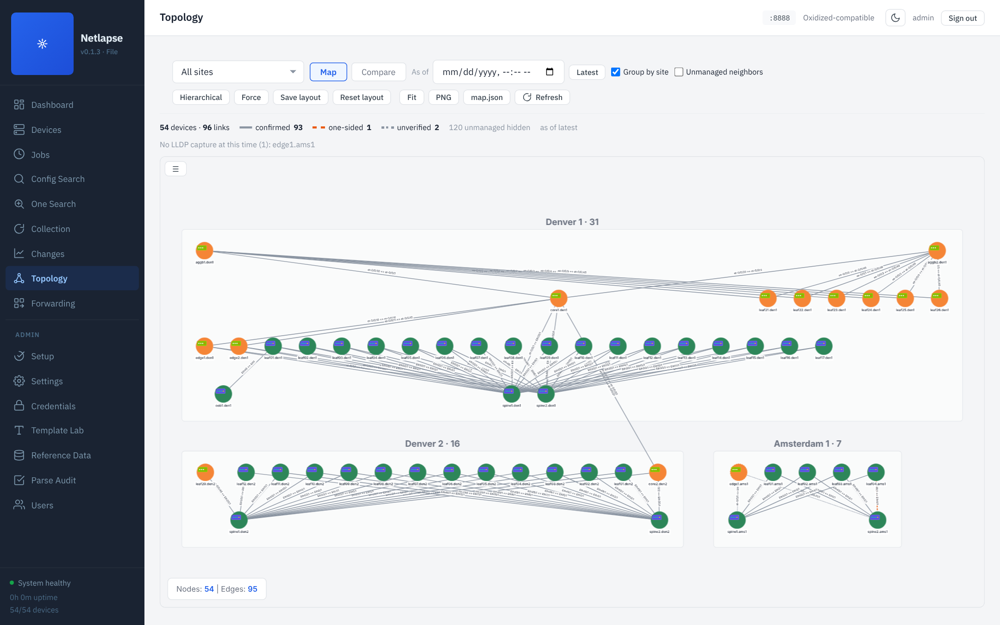

Because the source is versioned storage, the map can be drawn **as of** any stored time, and **Compare** shows what moved between two points — links added, removed, or changed state — with recent LLDP collection cycles offered as one-click windows:

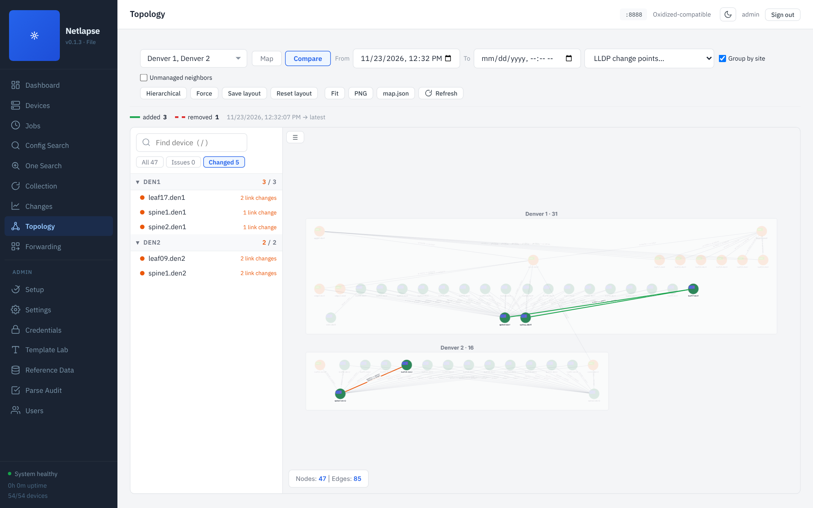

Opening a device fills its dialog from stored captures at the map's time — interfaces, LLDP neighbors, ARP, MAC table, config, and a raw tab for every other capture (BGP, OSPF, routes, custom jobs) — with each tab naming the capture it came from and when it was collected. Tables copy as aligned text or download as CSV; raw captures copy or download.

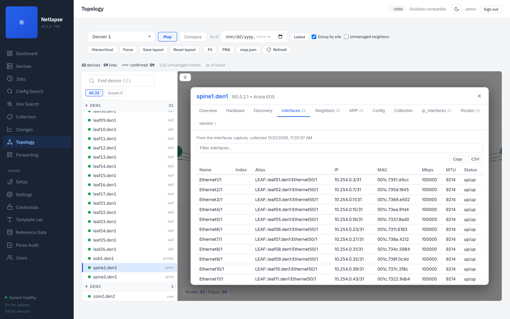

Rendering is Secure Cartography's viewer, ported to run in the browser; the `map.json` export opens in SC2. Full detail, with a screenshot walkthrough and the Junos and Arista notes for existing installs: [README_Topology.md](README_Topology.md).

## Forwarding

The same stored captures answer **how does A reach B**. The forwarding model does a longest-prefix match on every device's stored route table, ties each next hop to a device by address ownership and LLDP, and follows the result: every leaf to every other leaf, both directions, without touching a device. It shows which paths leave on a single uplink, which return over different devices than they went out on, which ride a default or an aggregate, and which end in a black hole.

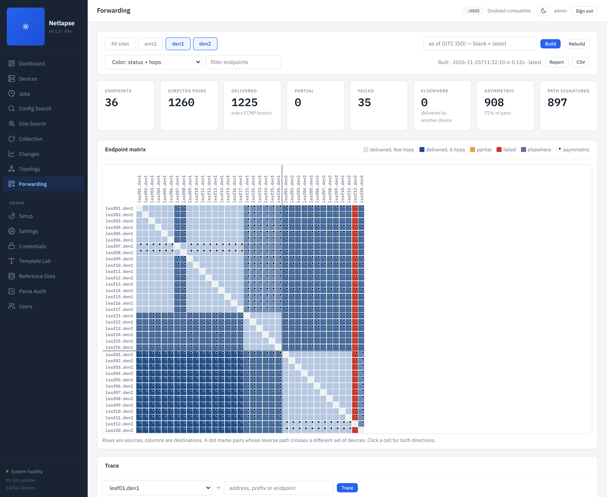

Click any cell for both directions hop by hop, or trace from any device to any address. Like Topology, the model can be built **as of** any stored time, so a change shows up as the matrix before and after. Full detail: [README_Forwarding.md](README_Forwarding.md).

## One Search

Type one token — an IP, a MAC, an ASN, a hostname, a serial — and get *everything* that references it across the whole fleet, grouped by what it means. It's the structured version of the 2 AM `grep`: instead of grepping one device at a time, you ask once and the answer comes back organized.


A single search returns two answers:

- **Identity** — which managed device this token *is*. A management or OOB address, a hostname, a serial, an asset tag resolves to the device that owns it, with a link to its detail page.
- **References** — everywhere it's *seen*, grouped by capture type (config, ARP, MAC table, BGP, routes, version, …) then by device, with the matching lines highlighted. Open any hit to the full capture and copy it whole.

The matching is format-aware, because the value never appears the same way twice across a mixed fleet:

- **IP** is octet-anchored — searching `10.7.255.35` will not drag in `10.7.255.350` or `10.1.1.1`.
- **MAC** matches every vendor representation from one keystroke — `d4af.f76c.45ad` also finds `d4:af:f7:6c:45:ad`, `d4-af-f7-6c-45-ad`, and `d4aff76c45ad`.
- **ASN** matches with or without the `AS` prefix, so `AS64512` and `remote-as 64512` both surface.

It reads the captures Netlapse already stores — a query over the dual-artifact tree, not a second index to keep in sync. Trace a `/31` link subnet to the device that advertises it, pivot from its ARP entry to the chassis MAC in `show version`, and confirm they're the same box, in two searches.

## Semantic Diff

Two snapshots, one question that matters at 2 AM: did the network change, or did a timer tick? Semantic diff compares parsed records instead of raw text. It matches each record by its identity — an ARP entry by IP, a BGP session by neighbor, an OSPF adjacency by neighbor ID — and reports only meaningful state changes: a MAC relearned on a different interface, a peer dropped to Idle, a route's next-hop moved. Volatile fields that tick every poll — age timers, uptimes, counters — are excluded by default, so the diff stays quiet when nothing operationally significant happened.

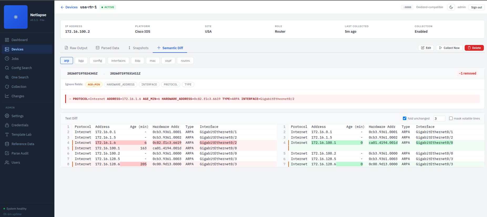

Captures with no record identity — running-config chief among them — fall through to the text diff. The semantic panel has nothing to say, and the unified diff below it carries the answer:

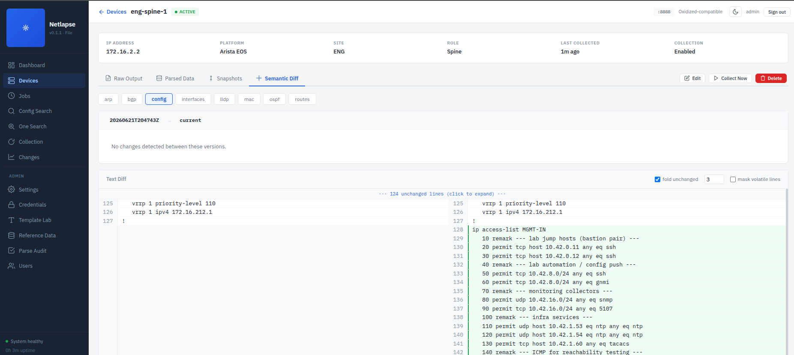

### How a record's identity is chosen

Matching by identity only works if the identity is right, and "the ARP table is keyed by IP" stops being true the moment a second vendor's template names that column something else. Netlapse resolves the key per capture type, per snapshot, against the data actually present.

Each capture type carries an ordered list of **candidate keys**, each possibly composite — `["IP_ADDRESS"]`, then `["INTERFACE", "PROTO", "LOCAL"]`, and so on. Candidates are tried in order against the records in hand: one whose fields are missing on either side is skipped, and one that doesn't produce a unique value for every record is rejected. The first candidate that uniquely identifies every record wins, so a wider composite is selected automatically when a narrower one collides — no per-vendor curation.

Uniqueness is the only disqualifier, and it is sufficient. A blank column collides on its second row; a part number reused across forty line cards collides forty times; a placeholder like `-` collides immediately. Rejecting fields for *looking* unusable was tried and removed — it cost roughly 1,600 snapshots their semantic diff to avoid a weakness uniqueness already catches.

When no candidate survives, the diff **degrades loudly** to a whole-record hash comparison rather than silently keying on something wrong; hash comparison preserves multiplicity, so duplicate records still count. Parse Audit surfaces the same analysis per device, and `tools/audit_keys.py` runs it across a real storage tree — resolved key, collisions, and document routing per capture type, exiting non-zero when something needs attention. Detail: [README_Symantic_Diff.md](README_Symantic_Diff.md).

## Change Feed

Semantic diff answers "what changed on *this* device." The Change Feed answers the aggregate: across the fleet in a time window, which devices and which capture types actually moved — with volatility filtered out, so an ARP age timer or a config commit-timestamp never reads as drift. It defaults to config and filters by capture type, site, and change kind (`drift`/`new`/`gone`).

It's two-phase, because deciding realness means diffing: a cheap enumeration lists candidates (a history walk, filenames only), then a batched verify runs the semantic verdict on the drift candidates and streams the confirmed ones in. That verdict is computed the same way the per-device Semantic Diff computes it, so the feed and the drill-in can't disagree — and the **Dashboard's 48-hour config-change counter** reuses the same pipeline, so the number on the dashboard matches what you see when you open the feed.

## Parsing and the Template Lab

Parsing is tfsm-fire — "output selects template." Rather than mapping each command to a template by hand, the engine scores the raw output against every candidate TextFSM template and keeps the best, so a new vendor or OS version usually parses with no configuration. The shipped `tfsm_templates.db` carries 1,276 templates (108 Cisco IOS, 72 NX-OS, 45 Arista EOS, 36 ASA, 22 Huawei VRP, 20 Juniper Junos, plus Fortinet, HP, Palo Alto, Dell and others).

The Template Lab runs any raw capture through the engine and shows the score broken out by factor, and templates can be edited in place:

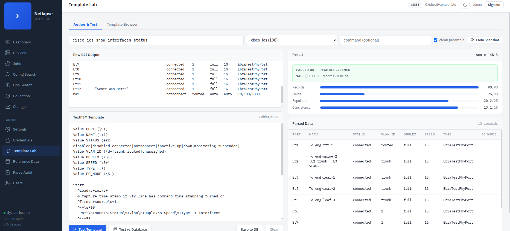

Parsed data renders as sortable tables on each device, exportable to CSV:

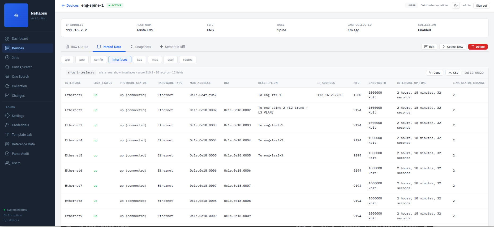

## LibreNMS and Oxidized Compatibility

Netlapse serves the Oxidized REST surface LibreNMS uses, so LibreNMS renders Netlapse's configs, version history and diffs under each device's **Config** tab, and its **Refresh** button triggers an on-demand collection. Validated end to end against a live LibreNMS instance.

<p align="center">
  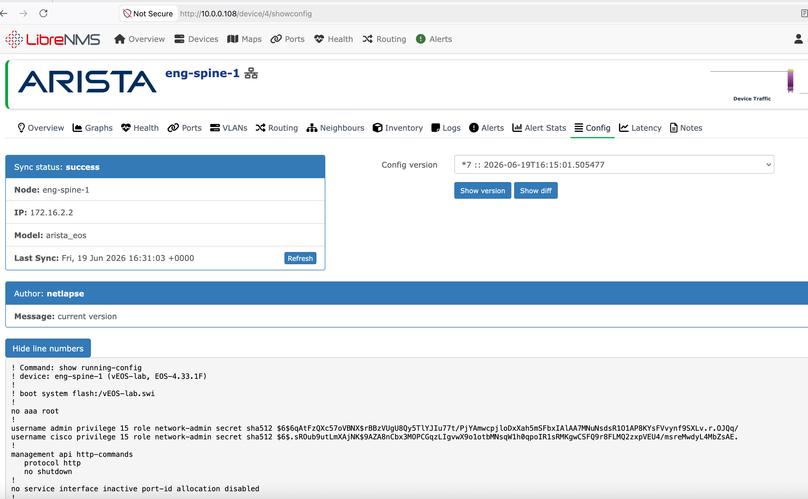
  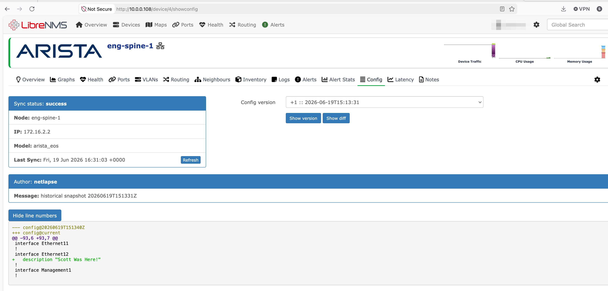
</p>

LibreNMS needs only `oxidized.url` pointed at Netlapse; Netlapse needs `auth.oxidized_public: true`, because LibreNMS stores a bare URL and can't send credentials. Wiring, auth modes and the naming requirements that decide whether configs render: [README_Config.md](README_Config.md). Endpoint list: [Oxidized compatibility](#oxidized-compatibility).

## Claude Access via MCP

`netlapse_mcp/` is an MCP server that gives Claude (Claude Code in the terminal or VS Code) read access to Netlapse: inventory, parsed capture data with server-side filters and paging, config search, One Search, version history, semantic diffs and the change feed. It can trigger Collect Now for a device's job-defined captures, with a human approval on every call. It has no SSH path and can't run arbitrary commands, and it can't pull whole captures — a full route table stays on the server.

The limits are enforced on the token as well as in the tools: `python -m netlapse token --name mcp` prints a read-only API token and the `auth.readonly_api_tokens` snippet that enables it (`--collect` to allow Collect Now). Setup and the tool list: [netlapse_mcp/README.md](netlapse_mcp/README.md).

## Backup and Restore

Settings → **Backup & Restore** snapshots the deployed state — `config.yaml`, the definition files, the DCIM database (devices, jobs, history, users), the credential vault (still encrypted), and optionally the capture data — into a downloadable archive, and stages a restore from one. The same is available from the CLI (`netlapse backup`, `netlapse backup list`, `netlapse restore ARCHIVE`); a restore is applied immediately if the daemon is stopped, otherwise on its next start.

## Quick Start

Netlapse isn't published to PyPI yet; install from source (Python 3.10 or newer):

```bash
git clone https://github.com/scottpeterman/netlapse.git
cd netlapse
pip install -e .
python -m netlapse
```

The file storage backend works out of the box. For the git backend (`storage.backend: git`), also `pip install gitpython` — see [Dependencies](#dependencies).

### First-run setup (web)

Start the daemon on a fresh install and browse to `http://127.0.0.1:8888/setup`. A six-step wizard covers the admin account, credential vault, SSH credential, device import, template database and review. The first visitor becomes admin, so run it before the port is reachable by anyone else. Walkthrough with screenshots: [README_Getting_Started.md](README_Getting_Started.md#fast-path-the-setup-wizard).


The rest of this section is the equivalent CLI path.

### Import devices from a Secure Cartography map

In the UI, admins use **Devices → Import map**: it opens the setup wizard's Devices step, where a `map.json` is uploaded, previewed and then imported. The preview marks every device **new**, **change** (with each field it would change, current → map) or **unchanged**, and flags unrecognized platforms. **Update existing devices** off imports only new devices and leaves existing ones — including hand-edited IPs and roles — as they are. A platform the map can't resolve never replaces a known one. Other options cover forcing a site, excluding hostname prefixes, skipping unrecognized platforms, and whether imported devices collect. Devices with no credential assigned use the vault's default credential, so they collect on their next scheduled run. The CLI does the same:

```bash
# Dry run — parse and report, no writes
python -m netlapse sync-map /path/to/map.json --dry-run

# Import — creates sites, assigns roles, detects platforms
python -m netlapse sync-map /path/to/map.json

# Exclude OOB management switches
python -m netlapse sync-map /path/to/map.json --exclude-prefix oob

# Add new devices only; leave existing devices' IP, platform and role alone
python -m netlapse sync-map /path/to/map.json --new-only
```

`--dry-run` lists each existing device the import would change, field by field.

The importer understands two hostname conventions:

| Convention | Example | Device Name | Site |
|---|---|---|---|
| Dot-separated (datacenter/SP) | `border01.site1.company.com` | `border01.site1` | `site1` |
| Dot-separated (datacenter/SP) | `peer1-01.site1` | `peer1-01.site1` | `site1` |
| Dash-prefixed (campus/enterprise) | `den-core-01` | `den-core-01` | `den` |

Device names keep the operational hostname — domain suffixes are stripped but the site segment stays, because it's part of the identity (`border01.site1` and `border01.den2` are different devices). Roles are inferred from hostname patterns (`border*` → router, `tor*` → leaf, `-core-` → core, `-sw-` → access), and the rules are yours to change in `roles.yaml` (see [Data-Driven Collection](#data-driven-collection)). Platforms are parsed from SC2's discovery strings (`Arista DCS-7280SRA-48C6-F EOS 4.33.1.1F` → `arista_eos`, `Cisco IOS-XE 17.03.06` → `cisco_ios_xe`, `Juniper JUNOS 23.2R1-S2.5` → `juniper_junos`). Idempotent — safe to re-run after every discovery cycle.

### Credential vault and collection

```bash
# Initialize the vault with a master password
python -m netlapse vault init

# SSH credential with key auth (or -p for password, or both for key + enable)
python -m netlapse vault add-ssh prod -u netops -k ~/.ssh/id_ed25519 --default

# Assign it to all devices (or --site den for one site), then check
python -m netlapse vault assign prod
python -m netlapse vault list

# One-shot collection
export NETLAPSE_VAULT_PASSWORD="your_master_password"
python -m netlapse collect --site den
python -m netlapse collect --job config-backup

# Start the daemon: scheduler + API + web UI
python -m netlapse
```

The vault stores key file contents encrypted — the original file isn't read at runtime, so the daemon doesn't need filesystem access to the key. Browse the web UI at `http://localhost:8888` and the Swagger API docs at `http://localhost:8888/docs`.

## Data-Driven Collection

What Netlapse collects — and how each vendor's CLI says it — is defined in YAML files, not code. They sit beside `config.yaml` (default `~/.netlapse/`) and are copied there from the package defaults on first run:

| File | Defines |
|---|---|
| `captures.yaml` | The catalog of collectable artifacts: a vendor-neutral intent plus the per-platform command |
| `jobs.yaml` | Bindings: which capture runs against which devices |
| `roles.yaml` | Hostname → device-role rules used by `sync-map` (optional; built-in defaults otherwise) |
| `volatility.yaml` | Diff-time noise policy: parsed fields and config lines excluded from diffs by default |

A capture's `command` is one string for everyone, or a map keyed by platform slug with a reserved `default`:

```yaml
captures:
  bgp-summary:
    capture_type: bgp
    description: BGP session state
    command:
      default: show ip bgp summary
      juniper_junos: show bgp summary
    interval: 900
```

A binding carries no command syntax and no interval — only the device selection:

```yaml
jobs:
  bgp-summary:
    capture: bgp-summary
    name: BGP summary
    enabled: true
    filters:
      platform: cisco_ios,arista_eos,juniper_junos
```

Adding a vendor, a capture or a whole new artifact type is a file edit and a restart:

```bash
python -m netlapse definitions validate    # offline, all-or-nothing check
python -m netlapse definitions sync        # project into the jobs table (or just restart)
```

The new capture type then appears in the UI's capture type selectors with no template or schema work.

**Files are authoritative for definitions; the DB owns runtime state.** A sync reconciles the jobs table to the files — insert new, update changed, tombstone removed — but never touches the live enable/disable toggle, the schedule, or job history. Validation runs over the whole catalog at once and is fail-soft: every problem is reported in one pass and the sync is skipped rather than half-applied, so the daemon keeps running on the last-good definitions in the DB. `definitions list` and `definitions adopt` (take over jobs that predate the registry) round out the CLI. See [Design Decisions](#design-decisions) for why definitions are file-authoritative while platforms stay in the DB.

**Default capture set** (seeded as editable jobs; a `jobs.yaml` binding with the same slug takes them over):

| Job | Capture Type | Default command | Per-platform overrides | Interval |
|---|---|---|---|---|
| Config Backup | `config` | `show running-config` | Junos `show configuration \| display set` | 1 hour |
| ARP Table | `arp` | `show ip arp` | Junos `show arp no-resolve`, EOS `show arp` | 30 min |
| BGP Summary | `bgp` | `show ip bgp summary` | Junos `show bgp summary` | 15 min |
| Interface Status | `interfaces` | `show interfaces` | | 30 min |
| Route Table | `routes` | `show ip route` | Junos `show route` | 30 min |
| OSPF Neighbors | `ospf` | `show ip ospf neighbor` | Junos `show ospf neighbor` | 30 min |
| MAC Address Table | `mac` | `show mac address-table` | Junos `show ethernet-switching table` | 30 min |
| LLDP Neighbors | `lldp` | `show lldp neighbors detail` | Junos `show lldp neighbors` | 30 min |

`Route Table` collects the full RIB; on devices carrying full Internet tables, scope it with a job filter or a narrower command.

## Authentication

Netlapse authenticates against local accounts, a directory, or both. `auth.provider` selects the chain:

| Provider | Behavior |
|---|---|
| `local` | scrypt-hashed accounts in the application database |
| `ldap` | directory only |
| `ldap+local` | directory first, local accounts as break-glass fallback |

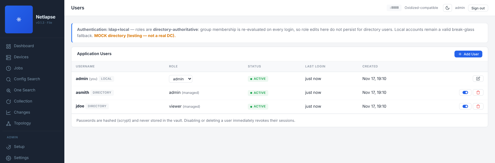

**The bind flow is service-bind → locate → proxy-bind.** A service account finds the user's DN, and the user's own credentials are then bound against the directory — the service account never validates a password. The username is filter-escaped before it reaches the search filter, and an empty password is rejected before any network call, because a bind with a DN and an empty password is treated as an anonymous success by many directories. A directory that can't be reached returns *directory unavailable* rather than *invalid credentials*, so an outage is distinguishable from a bad password in the logs.

**Transport is explicit.** `use_ssl` (LDAPS) and `start_tls` (in-band upgrade) are mutually exclusive, and setting both is a startup error. A StartTLS negotiation that fails fails the login rather than falling back to a cleartext bind. Setting neither is allowed and logs a warning.

**Roles are directory-authoritative.** Group membership is re-evaluated on every login and mapped to a role, so editing a directory user's role in the UI does not stick. A local shadow row gives the user a stable identity but carries an unusable random password and can never be logged into through the local provider. Disabling a user in the UI *is* durable — local disable wins over the directory, which makes it the fastest way to revoke someone.

**Mock mode** simulates the directory in memory, so the real login page can be exercised with no domain controller (the screenshot above was taken in mock mode). Only the transport is simulated: the service bind, search, proxy bind, group gate and shadow-row provisioning all run as in production. It logs a loud warning whenever it is active.

**Break-glass.** `NETLAPSE_ADMIN_PASSWORD` resets the *local* admin account, which only has a login path when a local provider is in the chain. Under pure `ldap` it can't get you back in, and startup warns if it's set. `ldap+local` keeps that door open by design.

**Machine access.** `auth.api_tokens` are bearer tokens with admin rights; `auth.readonly_api_tokens` (created with `netlapse token`) are read-only, optionally allowed to trigger Collect Now — the MCP server uses one.

Three behaviors are deliberate, tested, and worth knowing before deployment:

- **An empty `allowed_groups` is an open gate.** Every user who binds is admitted at `default_role`. Set it explicitly outside a lab.
- **A bare group token matches the CN in any OU.** Use a full DN when two OUs can carry the same name.
- **Group membership is direct only.** `memberOf` is not transitive in Active Directory, so a user in a nested group reads as not a member.

Full key reference: [README_Config.md](README_Config.md#auth--authentication-and-authorization). The LDAP test server: [README_LDAPd.md](README_LDAPd.md).

## Configuration

```yaml
# ~/.netlapse/config.yaml
listen:
  host: 0.0.0.0
  port: 8888

storage:
  backend: file           # file or git
  path: ~/.netlapse/data
  max_versions: 50        # file backend only — versions kept per device and capture type

dcim_db: ~/.netlapse/netlapse.db

scheduler:
  poll_interval: 15       # seconds between due-job checks
  max_workers: 2          # concurrent collection threads

parser:
  # db_path: ~/.netlapse/tfsm_templates.db  # auto-detected if omitted
  # min_score: 15.0                          # minimum template match score (0-100)

auth:
  provider: local         # local | ldap | ldap+local
  session_ttl: 604800     # 7 days
  cookie_secure: false    # true when serving over HTTPS
  # ldap: ...             # see README_Config.md

emulation:
  enabled: false          # true redirects SSH to NetEmulate mock devices (testing)
```

The config path can be overridden with `NETLAPSE_CONFIG`; the definition files follow it unless `definitions_dir` is set. Every key is documented in [README_Config.md](README_Config.md), and the running config can be edited from Settings in the UI.

Environment variables:

| Variable | Purpose |
|---|---|
| `NETLAPSE_VAULT_PASSWORD` | Master password for headless vault unlock (the scheduler needs the vault open) |
| `NETLAPSE_CONFIG` | Config file path override |
| `NETLAPSE_ADMIN_PASSWORD` | Reset the local `admin` password at startup |
| `NETLAPSE_LDAP_BIND_PASSWORD` | Conventional name for the LDAP service-account password (the variable read is whatever `auth.ldap.bind_password_env` names) |

## CLI

| Command | Does |
|---|---|
| `python -m netlapse` / `serve` | Start the daemon: scheduler, API, web UI |
| `sync-map MAP.json` | Import sites, roles, platforms and devices from an SC2 map (`--dry-run`, `--new-only`, `--exclude-prefix`, `--site`, `--roles`) |
| `vault init` / `add-ssh` / `list` / `assign` / `delete` | Credential vault management |
| `collect` | One-shot collection by filter (`--site`, `--role`, `--credential`) or `--job SLUG` |
| `definitions validate` / `sync` / `list` / `adopt` | The definition catalog |
| `fetch-templates` | Download the TextFSM template database |
| `backup` / `backup list` / `restore ARCHIVE` | Back up and restore deployed state |
| `token --name NAME [--collect]` | Print a new read-only API token and its config snippet |
| `cleanup` | Storage report: orphaned device directories and per-capture disk use (dry-run only, deletes nothing) |

Repo-root scripts that talk to a running instance over the API (stdlib only): `netlapse_import_map.py` (map import through the API), `netlapse_prune_ip_devices.py` (remove devices named by bare IP from unresolved discovery), and `netlapse_api_example.py` (an authenticated client to start from). `python -m netlapse.parse_test DEVICE --capture TYPE` runs collect → clean → parse → store for one device with step-by-step output.

## Architecture

```
┌──────────────────────────────────────────────────────┐
│  FastAPI application (port 8888)                     │
│  ├── /nodes, /node/*  → Oxidized-compatible API      │
│  ├── /api/v1/*        → Native API (+ /docs)         │
│  ├── /ws              → WebSocket (live progress)    │
│  ├── /setup, /login   → First-run wizard, auth       │
│  └── /                → Web UI (vanilla JS SPA)      │
└────────────────────┬─────────────────────────────────┘
                     │
┌────────────────────▼─────────────────────────────────┐
│  Scheduler (asyncio + ThreadPoolExecutor)            │
│  ├── Poll loop: due jobs every 15 s                  │
│  ├── Queue: scheduled runs + API / LibreNMS triggers │
│  ├── Workers: collect → parse → store per device     │
│  └── History + WebSocket broadcast                   │
└────────────────────┬─────────────────────────────────┘
                     │
┌────────────────────▼─────────────────────────────────┐
│  Collection                                          │
│  ├── Registry (captures / jobs / roles / volatility) │
│  ├── Vault (Fernet / PBKDF2, separate database)      │
│  ├── SSH client (Paramiko, legacy algorithm support) │
│  └── Parser (tfsm-fire, 1,276 templates)             │
└────────────────────┬─────────────────────────────────┘
                     │
┌────────────────────▼─────────────────────────────────┐
│  Storage                                             │
│  ├── File or git backend: raw .txt + parsed .json    │
│  ├── DCIM SQLite: devices, jobs, history, users      │
│  └── Readers over it: diff, change feed, One Search, │
│      topology (any point in time), capture API, MCP  │
└──────────────────────────────────────────────────────┘
```

### Collection data flow

```
Poll loop / API trigger / LibreNMS Refresh
    │
    ▼
Job → resolve devices (filters) → resolve per-platform command (shared resolver)
    │
    ▼
Vault: device credential_id → key and/or password
    │
    ▼
SSH: connect → detect prompt → disable paging → (enable) → run commands
    │   platform fields drive it: paging command, prompt regex, enable, legacy SSH
    ▼
Parser: clean output → {platform}_{command} templates → vendor fallback → best score
    │
    ▼
Storage: {site}/{device}/{capture}.txt + {capture}.json
    │   file backend: previous version rotated to _history/ when the raw text changes
    │   git backend: one commit per device, machine-readable trailers
    ▼
DCIM: per-device result, job history; WebSocket events to the UI
```

### Module map

```
netlapse/
├── __main__.py         CLI dispatch (serve, sync-map, vault, collect, definitions,
│                       fetch-templates, backup, restore, token, cleanup)
├── app.py              FastAPI app, lifespan, vault unlock, parser init, scheduler, auth wiring
├── backup.py           Backup / restore of deployed state
├── parse_test.py       Single-device collect + parse diagnostic
├── api/
│   ├── native.py       Devices, snapshots, diffs, jobs, history, collection, search
│   ├── captures.py     Bounded capture reads: metadata, filtered records, gated raw lines
│   ├── topology.py     Map, compare, change points, device-dialog detail
│   ├── changes.py      Fleet change feed: enumerate + batched semantic verify
│   ├── parse_audit.py  Per-device parse trust and key collision reporting
│   ├── admin.py        System, config editor, vault credentials, templates
│   ├── dcim_admin.py   Sites, platforms, roles
│   ├── backup.py       Backup / restore jobs and archives
│   ├── setup.py        First-run wizard
│   └── oxidized_compat.py  Oxidized REST surface for LibreNMS
├── auth/               Local + LDAP providers, sessions, tokens, login and user admin
├── core/collector.py   Collection pipeline (DCIM → vault → SSH → parse → storage)
├── dcim/               SQLite schema and migrations, SC2 map importer, repair utilities
├── registry/           Definition catalog: loader, validation, sync, command resolver, volatility
├── parser/             tfsm-fire engine and the parse engine around it
├── scheduler/          Poll loop, queue, workers, WebSocket broadcast
├── ssh/                Paramiko client, executor, jump-host support, NetEmulate shim
├── storage/            File and git backends, diff engine, token matching, cleanup report
├── topology/           LLDP normalization, name resolution, point-in-time reads, map build, diff
├── vault/              Encrypted credential store and its DCIM bridge
└── web/static/         SPA shell, CSS themes, view modules, ported topology viewer

netlapse_mcp/           MCP server for Claude
tools/                  audit_keys.py, ldapd.py (stdlib LDAP test server), fix_arista_lldp_template.py
tests/                  pytest suite
```

### Web UI

A single-page app with no build step: vanilla JS ES modules, a hash router, and one module per view loaded on demand. Every view implements the same lifecycle — `render()` returns HTML, `init()` fetches data and wires events, `destroy()` cleans up timers and subscriptions. Light and dark themes, per user.

| View | Route | Purpose |
|---|---|---|
| Dashboard | `#/dashboard` | Stat cards (incl. 48-hour config changes), sites, scheduled collection table |
| Devices | `#/devices` | Filterable inventory; deep-linkable filters (`#/devices?site=den`) |
| Device Detail | `#/device/{id}` | Raw output, parsed tables, snapshot timeline, semantic diff per capture type; device edit; SSH auth test with debug log |
| Jobs | `#/jobs` | Job CRUD with per-platform command maps, enable/disable, run now |
| Config Search | `#/search` | Regex search across any capture type, with line numbers and match navigation |
| One Search | `#/onesearch` | One token → identity plus every reference, grouped by capture type |
| Collection | `#/collection` | Run a job and watch per-device progress live |
| Changes | `#/changes` | Fleet change feed, deep-linking into per-device semantic diff |
| Topology | `#/topology` | LLDP map: sites, as-of, compare, device list, device dialog, saved layouts |
| Setup | `#/setup` | First-run wizard; reopenable, each step reports live state |
| Settings | `#/settings` | System overview, config editor, data browser, backup and restore |
| Credentials | `#/credentials` | Vault credentials and assignment |
| Template Lab | `#/templates` | Test and edit the template library against real output |
| Reference Data | `#/reference` | Sites, platforms, roles |
| Parse Audit | `#/audit` | Parse trust per device, template attribution, key collisions, reparse |
| Users | `#/users` | Application users; directory users show their managed role |

### Platforms

Thirteen platforms are seeded with their SSH behavior. The `slug` is what devices reference and what `captures.yaml` override keys match; `profile` is the template-matching key (they differ on a few platforms, so author overrides with the slug):

| Platform | Slug | Profile | Paging command | Enable | Legacy SSH |
|---|---|---|---|---|---|
| Cisco IOS | `cisco_ios` | `cisco_ios` | `terminal length 0` | `enable` | |
| Cisco IOS-XE | `cisco_ios_xe` | `cisco_xe` | `terminal length 0` | `enable` | |
| Cisco IOS-XR | `cisco_ios_xr` | `cisco_xr` | `terminal length 0` | | |
| Cisco NX-OS | `cisco_nxos` | `cisco_nxos` | `terminal length 0` | | |
| Cisco ASA | `cisco_asa` | `cisco_asa` | `terminal pager 0` | `enable` | |
| Arista EOS | `arista_eos` | `arista_eos` | `terminal length 0` | | |
| Juniper Junos | `juniper_junos` | `juniper_junos` | `set cli screen-length 0` | | |
| Palo Alto PAN-OS | `paloalto_panos` | `paloalto_panos` | `set cli pager off` | | |
| Fortinet FortiOS | `fortinet_fortios` | `fortinet` | `config system console` / `set output standard` / `end` | | |
| F5 TMOS | `f5_tmos` | `f5_tmsh` | `modify cli preference pager disabled` | | |
| HP ProCurve | `hp_procurve` | `hp_procurve` | `no page` | | ✓ |
| HP Comware | `hp_comware` | `hp_comware` | `screen-length disable` | | ✓ |
| Dell OS10 | `dell_os10` | `dell_os10` | `terminal length 0` | | |

Legacy SSH can also be forced on or off per device. When active, the client offers DH group1 / 3DES and forces `ssh-rsa` (SHA-1) signatures for pre-2014 servers that don't support RFC 8332.

### Storage

Both backends store `{site}/{device}/{capture_type}.txt` (the raw output) and `.json` (the parsed records with template, score and collection time), and both only write a new version when the raw text changes.

- **File backend** — a directory tree; the previous version rotates into `_history/` with its timestamp, keeping `max_versions` per device and capture type. No dependencies; start collecting in a minute.
- **Git backend** — one commit per device with machine-readable trailers that survive `git clone`, `git bundle` and migrations:

```
X-Netlapse-Device: border-rtr-01
X-Netlapse-Site: site1
X-Netlapse-Trigger: scheduled
X-Netlapse-Types: config,arp,bgp
```

## API

Swagger UI at `/docs` enumerates every route. By area:

| Area | Prefix | Routes |
|---|---|---|
| Core: devices, snapshots, diffs, jobs, history, collection, search | `/api/v1` | 34 |
| Capture reads (bounded, for scripts and MCP) | `/api/v1/devices/{id}/captures` | 3 |
| Topology | `/api/v1/topology` | 6 |
| Change feed | `/api/v1/changes` | 2 |
| Parse audit | `/api/v1/parse-audit` | 2 |
| Auth: login, logout, me, password, theme | `/api/v1/auth`, `/login` | 6 |
| Admin: system, config, vault, templates | `/api/v1/admin` | 17 |
| Admin: users | `/api/v1/admin/users` | 5 |
| Admin: DCIM reference data | `/api/v1/admin/dcim` | 5 |
| Admin: backup and restore | `/api/v1/admin/backup` | 8 |
| First-run setup | `/setup`, `/api/v1/setup` | 7 |
| Oxidized compatibility | `/` | 12 |
| WebSocket | `/ws` | 1 |

### Oxidized compatibility

| Oxidized endpoint | Method | Notes |
|---|---|---|
| `/nodes` | GET | Optional `?group=` filter by site slug |
| `/node/show/{node}` | GET | Node metadata (name, ip, model, group, last) |
| `/node/fetch/{node}` | GET | Resolves by name or IP |
| `/node/fetch/{group}/{node}` | GET | Scoped to site slug |
| `/node/version` | GET | Git commits or file versions |
| `/node/version/view` | GET/POST | A specific version, plain text |
| `/node/version/diffs` | GET | Unified diff between two versions |
| `/reload` | GET | Returns device count |
| `/node/next/{node}` | GET/PUT | Enqueues collection — **opt-in**, IP-scoped (LibreNMS Refresh sends PUT) |
| `/nodes/conf_search` | POST | Regex search across configs (gated) |

Under `oxidized_public` the read routes are unauthenticated — the upstream Oxidized trust model. The trigger route stays off until source IPs are listed in `oxidized_public_trigger_ips`; that grant is a strict subset of read access. `/nodes/conf_search` and every admin and vault route stay behind the normal gate.

## Tests

```bash
pip install -e ".[dev]"
pytest
```

**335 tests**, concentrated where being quietly wrong is worse than failing — record identity, authentication, the noise policy that decides what counts as a change, and the map's link decisions.

| Module | Tests | Covers |
|---|---|---|
| `test_token_match.py` | 88 | Format-aware matching — every MAC representation, octet-anchored IPs, ASN with and without `AS` |
| `test_diff.py` | 76 | Candidate key resolution, composite keys, collision detection, loud degradation to hash diff, volatility exclusion |
| `test_auth_providers.py` | 58 | Local and LDAP providers, group gate, admin elevation, shadow rows, local-disable precedence, filter escaping |
| `test_volatility.py` | 52 | Field-level and config-line noise policy, code baseline unioned with YAML |
| `test_ldapd.py` | 36 | The LDAP fixture itself and the client behaviors it pins (BER, filters, referrals, StartTLS, fault injection) |
| `test_topology.py` | 22 | LLDP field variants, cross-vendor port matching, link states, cross-site guard, site scope, as-of on both backends, compare |
| `test_map_import.py` | 3 | Map import: preview matches the import field for field, `--new-only` keeps hand edits, an unknown platform never clears a known one |

Two deserve a note on *how* they test.

**The diff tests run against real storage shapes.** `tools/audit_keys.py` walks an actual snapshot tree and reports the resolved key, collisions and document routing per capture type; the cases it surfaced — blank `IP_ADDRESS` on layer-2 ports, part numbers reused across line cards, Junos per-address-family interface rows, ECMP default routes — became the test cases.

**The LDAP tests run against a real LDAP server.** `tools/ldapd.py` is a purpose-built directory with hand-rolled BER in both directions (standard library only), an in-memory directory, runtime fault injection, and both LDAPS and StartTLS. A mocked connection can't observe the transport — the `start_tls` key was once read, stored and never acted on, and only a real socket showed it.

The two StartTLS tests in `test_ldapd.py` need a TLS-capable local socket and can fail in restricted sandboxes.

## Known Limitations

**Template mis-selection can store the wrong data under a capture type.** tfsm-fire chooses by score, and a confident wrong answer is possible: an audit of a live store found OSPF captures parsed with an LLDP template that matched column for column. The raw text is always preserved, but the parsed artifact is wrong. Making the `parse:` pin in `captures.yaml` authoritative rather than advisory is the fix and the next work item.

**Some templates emit one wide record where the data has many.** `juniper_junos_show_chassis_hardware` produces a single 69-column row per device, so semantic diff has nothing to key on.

**Some templates emit no unique identity.** A routes template with `PREFIX` but no next-hop can't distinguish ECMP paths; Junos internal units collide similarly. These fall through to hash comparison — correct, but coarser.

**Template bugs flow through to everything built on the parse.** Both NTC Arista `show lldp neighbors detail` templates let the Link Aggregation TLV's `Port ID : 0` overwrite the real port; the shipped database carries a fix and `tools/fix_arista_lldp_template.py` applies it to an existing one. Parse Audit and the Template Lab are where this class of problem shows up.

**Retention is short on volatile captures with the file backend.** At a 30-minute interval and `max_versions: 50`, a frequently changing capture's history spans roughly a day. Raise `max_versions`, or use the git backend, for anything you need further back — including topology as-of and compare.

**Directory group membership is direct only.** Nested Active Directory groups don't resolve — see [Authentication](#authentication).

## Roadmap

Open: authoritative `parse:` pins; store-time semantic deduplication to stretch retention; NetBox sync (optional, bidirectional); syslog-triggered collection; external device sources (LibreNMS / NetBox API); a per-template timeout guard in tfsm-fire for pathological regexes; FIB path checks as snapshotted, comparable captures drawn on the topology map.

Shipped since the first roadmap: application authentication with LDAP/AD, the data-driven definition registry, interval-change rescheduling, the first-run wizard, Template Lab editing, Parse Audit with reparse, backup and restore, the bounded capture API and MCP server, and the topology map.

## Design Decisions

**Why the network is the source of truth.** Resistance to NetBox adoption at the operator level drove an architectural pivot. VelocityCMDB required a populated NetBox; Netlapse doesn't. Each tool in the suite carries enough DCIM to operate on its own; if NetBox exists, sync to it. The SC2 topology map is the seed source — install, point at the network, start collecting.

**Why definitions are file-authoritative but DB-synced.** A YAML catalog is what an operator should edit — diffable, reviewable, version-controllable. But the daemon needs state that doesn't belong in a file: the live enable toggle, the schedule, job history. So definitions are authoritative in files and projected into the jobs table, while runtime state stays authoritative in the DB and is never clobbered by a sync. The DB doubles as the last-good cache: a typo degrades to "ran with last good definitions," never to "stopped collecting."

**Why platforms stayed in the DB.** Devices reference a platform by slug, and `dcim_platform` carries the live SSH behavior each one needs. A second platform list in a file could drift from the one devices resolve against, so a capture's per-platform keys are validated against `dcim_platform` at load time instead.

**Why the map is built from stored captures.** Discovery is a crawl with its own sessions, credentials and failure modes, and it answers only "what is it now." LLDP is already collected on a schedule; reading it from storage costs nothing on the network, and the versioned store makes "what was it then" and "what changed" free. Links are kept and tagged rather than dropped when the two ends disagree, because a one-sided adjacency is information.

**Why no netmiko.** The SC2 SSH client is battle-tested Paramiko: ANSI filtering, prompt detection, invoke-shell for devices that reject exec channels, and automatic registration of the kex and host-key handlers recent Paramiko omits, so mixed fleets negotiate from curve25519 down to DH group1 without retry chains.

**Why SQLite, not PostgreSQL.** Single-file deployment, no database server. WAL mode handles API reads while the scheduler writes; worker threads open their own connections, since SQLite connections can't cross threads.

**Why two storage backends.** Not everyone has or wants git. The file backend starts collecting in a minute; switching to versioned history is one config line.

**Why dual artifacts.** The raw text is what you `grep` at 2 AM. The parsed JSON is what makes structured diffs, search and the map possible. Keeping both means a parser fix can be replayed over history.

**Why a separate vault database.** The vault at `~/.netlapse/vault.db` is encrypted; the DCIM is not. Different security boundary. `credential_id` on a device is a logical reference resolved at runtime.

**Why commit trailers instead of a metadata database.** Trailers survive clone, bundle, migration and restore. A side-car database can fall out of sync.

**Why `site_slug` = Oxidized group = storage directory.** Three systems that must agree on a namespace; making them the same string removes mapping tables.

**Why vanilla JS.** No webpack, no node, no build. The next person maintaining this is a network engineer, not a frontend developer: they open `views/devices.js` and see HTML strings and fetch calls. Dynamic `import()` means the browser only loads the view being shown.

## Design Philosophy

The stack is deliberately inheritable: FastAPI, SQLite, vanilla JS, Paramiko — mainstream pieces, no exotic dependencies, pip-installable, GPL so it stays open.

## Portable Components

Netlapse reuses modules from the author's network automation stack:

| Component | Origin | Purpose |
|---|---|---|
| SSH client | Secure Cartography v2 | Paramiko wrapper: algorithm registration, key + password auth, ANSI filtering, prompt detection |
| Emulation shim | Secure Cartography v2 | NetEmulate mock-device redirection for testing |
| Credential vault | Secure Cartography v2 | Fernet-encrypted SQLite, headless unlock |
| tfsm-fire | Secure Cartography v2.5 | TextFSM auto-template selection |
| Topology viewer | Secure Cartography v2 | Cytoscape map viewer, ported from Qt WebEngine to the browser |
| SSH executor, DCIM schema | VelocityCollector | DCIM → SSH → snapshot pipeline; NetBox-aligned SQLite |
| Parse engine, map importer, scheduler, registry, topology builder, web UI | New for Netlapse | |

## Dependencies

Declared in `pyproject.toml`:

```
fastapi>=0.110          # web framework
uvicorn[standard]>=0.27 # ASGI server
python-multipart>=0.0.7 # form parsing (Oxidized-compatible endpoints)
pydantic>=2.0           # request / response models
PyYAML>=6.0             # configuration and definition catalog
paramiko>=3.0,<4.0.0    # SSH
cryptography>=42.0      # vault encryption
textfsm>=1.1            # template parsing
ldap3>=2.9              # directory authentication (imported lazily)
click>=8.0              # CLI
```

Development extras (`pip install -e ".[dev]"`): `pytest>=8.0`, `httpx>=0.27`.

**The git backend needs `gitpython`, which is not declared.** It's imported lazily, so the package installs and the file backend works, but `storage.backend: git` raises `ImportError` on first use until `pip install gitpython` is run. The MCP server needs `mcp>=1.30`, installed separately. `tools/ldapd.py` is standard library only. The record diff engine is pure standard library.

Python 3.10 or newer; tested on 3.12, 3.13 and 3.14.

## License

GPLv3

## Author

Scott Peterman — [Full Stack Net Ops Developer](https://scottpeterman.github.io)
