# Forwarding

The forwarding model answers "how does A reach B" from stored captures. It reads the route table, LLDP and interface addresses netlapse already collects, does a longest-prefix match on every device, and follows the next hops. Nothing is collected for it and no device is contacted: if the route, LLDP and address jobs run, the model exists. It can also be built for any past point in time the storage backend can reconstruct.

Two uses:

- **trace**: an offline fibtrace from one device to an address, prefix or endpoint.
- **matrix**: every endpoint (leaf/TOR) to every other endpoint, both directions, with an HTML heatmap, CSV and JSON.

Both are in the web UI under **Forwarding** (next to Topology), in the API, and on the CLI.

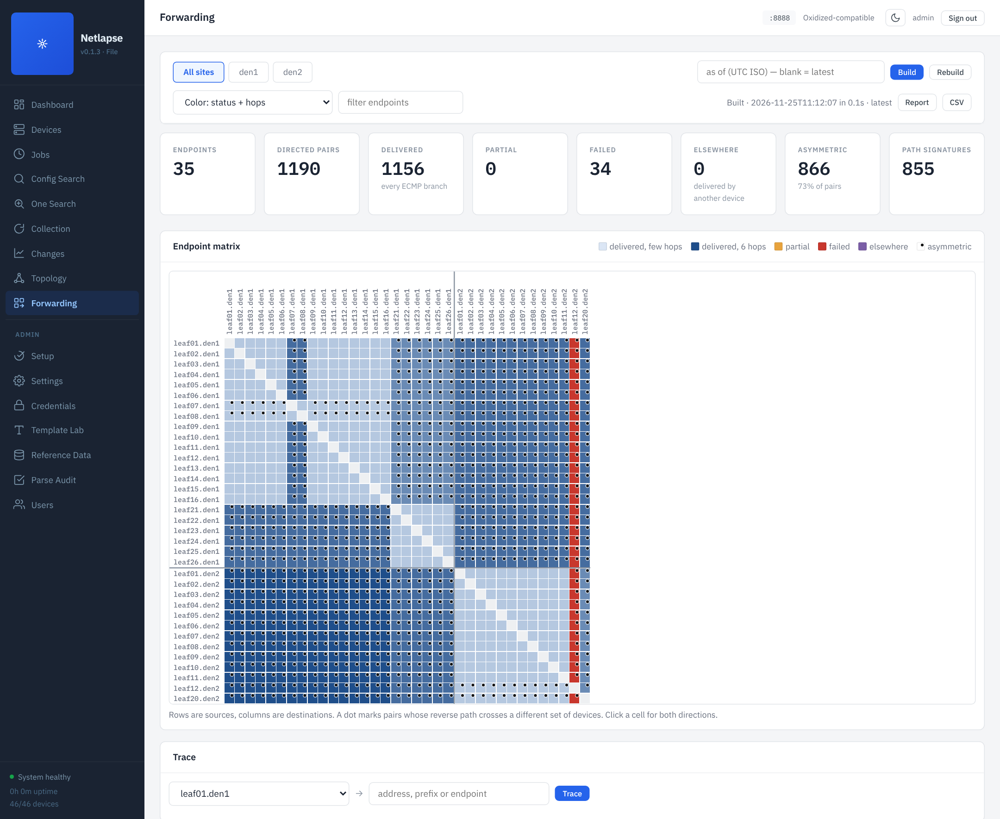

The screenshots on this page come from the synthetic demo network in `tools/demo_lab.py` (two sites, 35 leafs, a handful of deliberate faults), regenerated with `tools/screenshots.py`. None of it is a real network.

## Web view

`#/forwarding` builds the matrix for the selected sites, latest or as of a UTC time. Sites, time, color mode, selected pair and trace are in the URL, so any view below can be bookmarked or shared.

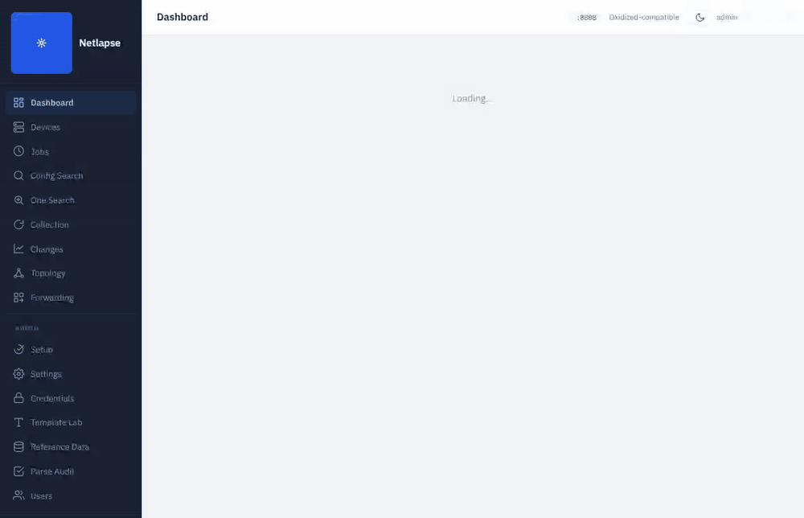

**A pair, both directions.** Click a cell. Each hop shows the device, the prefix it matched and whether that was **specific**, an **aggregate** or the **default**, and each next hop with how it was tied to a device. Here a DEN2 leaf reaches a DEN1 leaf through both DEN1 edges, because core1 only carries DEN1 as an aggregate learned from them; the return path goes straight from the DEN1 spines to core1 and never touches an edge.

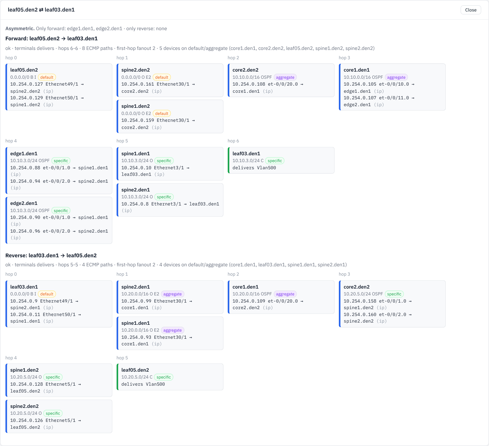

**First-hop fanout.** Colored by fanout, every leaf that forwards on a single uplink to every destination stands out. In the demo that's three different causes: leaf07/08.den1 lost their spine2 adjacency, the Junos pod (leaf21–26) lists both uplinks in the RIB but installs one, and leaf20.den2 hangs off a single SVI.

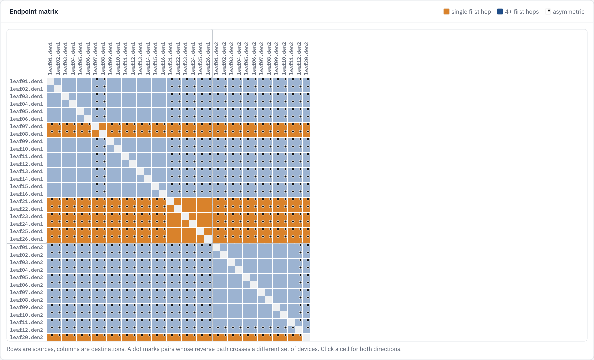

**As of a past time.** The same view two days earlier, before leaf07/08 lost their second uplink: their rows are blue. Comparing two times is how a change shows up.

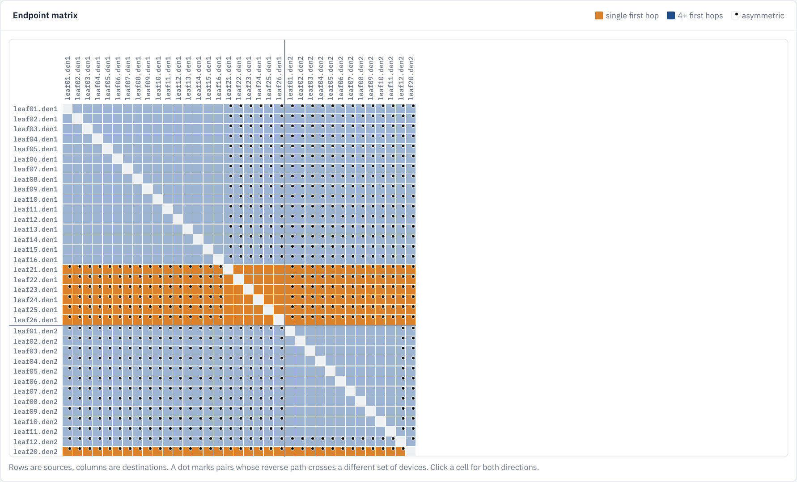

**Trace.** An offline fibtrace from any modeled device to an endpoint name, an address or a prefix. A trace to an endpoint, or to any address inside an endpoint subnet, answers from the cached model; anything else loads that address's covering routes first.

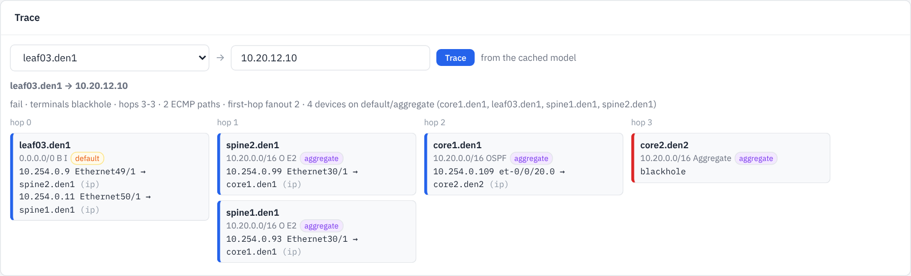

The long way round: spine2.den1 lost its port to leaf07, so it reaches it through core1, both edges and spine1.

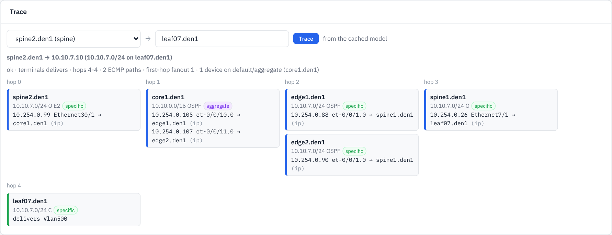

**Data quality and per-endpoint summary.** Stale route captures, route tables that can't be modeled, endpoints without a destination, addresses owned by more than one device, and what was excluded. The summary ranks endpoints by delivery, asymmetry and fanout; a highlighted row has something to look at.

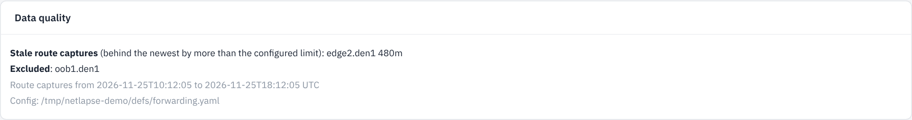

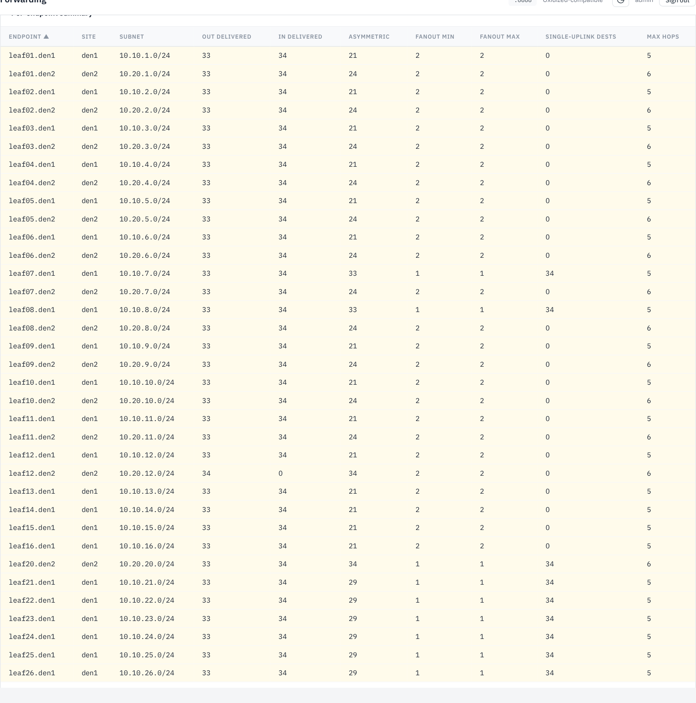

The view follows the app theme:

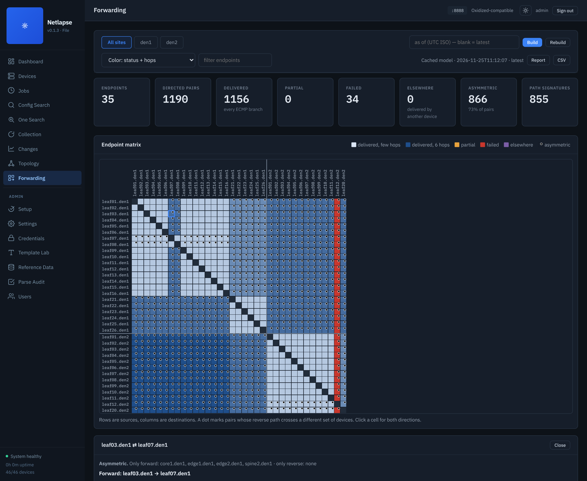

**Report** opens the same matrix as one self-contained HTML file (light theme, data embedded, no external assets) for mail or a ticket; **CSV** downloads one row per directed pair.

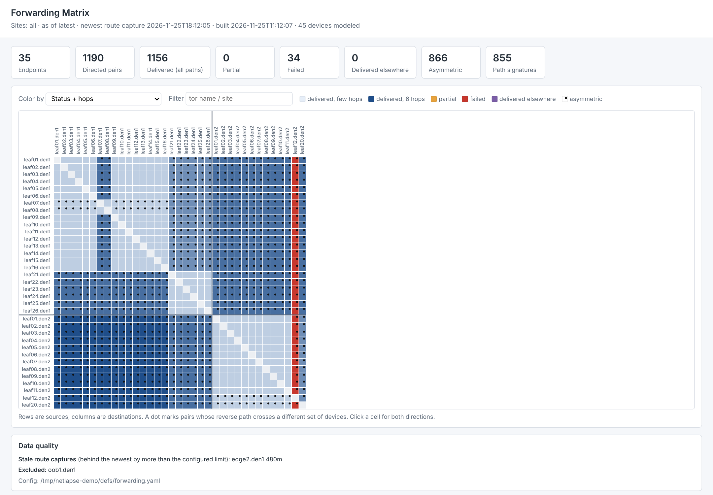

## API

| Endpoint | |
|---|---|
| `GET /api/v1/forwarding/matrix?site=a,b&as_of=&refresh=1` | matrix JSON plus `cache` info |
| `GET /api/v1/forwarding/trace?src=&dest=&site=&as_of=` | offline trace with per-hop layers |
| `GET /api/v1/forwarding/check?site=&as_of=` | per-device readiness |
| `GET /api/v1/forwarding/report?site=&as_of=` | the standalone HTML report |
| `GET /api/v1/forwarding/pairs.csv?site=&as_of=` | one row per directed pair |

The model is built once per (sites, as_of) and cached. For "latest" the cache key includes the modification time of every in-scope route, LLDP and address capture, so the first request after a collection run rebuilds and the rest reuse it; `refresh=1` forces a rebuild. A trace to an endpoint or any address inside an endpoint subnet uses the cached model. A trace to anything else (a transit prefix, an Internet address) loads that address's covering routes in a one-off model, which takes about as long as a cold build.

```
netlapse forwarding check --site iad1
netlapse forwarding trace tor424.iad2 10.7.22.10
netlapse forwarding matrix --site iad1 --site iad2 --out-dir forwarding_out
netlapse forwarding matrix --as-of 2026-11-20T12:00:00Z --out-dir before
```

## What the model needs

| Capture (capture_type) | Used for |
|---|---|
| `routes` | longest-prefix match, next hops, connected subnets |
| `lldp` | next hop → device when the address isn't owned by anyone known |
| `ip_interfaces`, then `interfaces` | which device owns which address |

All three are in the default job set. `ip_interfaces` (`show ip interface brief`, Junos `show interfaces terse`) is new: an existing deployment keeps its own captures.yaml and jobs.yaml, so copy the `ip-interfaces` capture and job from the packaged definitions into yours. Without it, SVI and LAG next hops fall back to LLDP, which often can't place them.

`netlapse forwarding check` lists every device with its route count, how many routes it could model, how many addresses it owns, LLDP neighbors resolved, and any problem. Run it first.

### Route templates

Two shipped route templates were unusable for forwarding and are fixed in the template database:

- `arista_eos_show_ip_route_v2` recorded each route before reading its ECMP `via` lines, so every row carried the previous route's last next hop: the first route had none, every route lost its first next hop, and connected routes weren't recorded. Fixed, and it now reads both the one-line `is directly connected` form and the two-line form newer EOS prints.
- `juniper_junos_show_route` captured no next hops. It now records the active path per prefix with its next hops, the `>` marker per next hop, the routing table, and Reject/Discard/Local.

A fresh install gets the fixed database. An existing one keeps its own (it may hold your template edits), so patch it and reparse:

```
python tools/fix_route_templates.py ~/.netlapse/tfsm_templates.db
python tools/netlapse_reparse.py --capture-type routes
python tools/netlapse_reparse.py --capture-type routes --persist
```

The reparse tool is a dry run until `--persist`, works one device at a time with progress, and only rewrites parsed data, never the raw capture.

## How a next hop becomes a device

1. **ip**: the next-hop address is owned by exactly one other device (Junos Local /32s, connected /32s such as loopbacks, interface addresses).
2. **ip+lldp**: several devices own it (anycast, a reused link address); the LLDP neighbor on the egress port picks one.
3. **lldp**: nobody known owns it; the LLDP neighbor on the egress port is a modeled device. Names resolve the same way the Topology view resolves them.

Anything else is an **exit**: transit, unmanaged gear, a device outside the selected sites, or missing address data. Every pair lists its exits, so a gap shows up instead of hiding.

## Endpoints and destinations

Configured in `forwarding.yaml` (definitions directory, next to captures.yaml; the packaged copy documents every key). Defaults:

- **Endpoints**: DCIM role `leaf` (roles.yaml maps `tor*` and `leaf*` to it).
- **Excluded**: hostnames matching `^(oob|c\d+[a-z]?\.)|-lab\.` (OOB switches, console servers, lab gear). Only active devices are considered.
- **Destination per endpoint**: its largest connected subnet inside RFC 1918, /16 to /29, that no other endpoint also has. A subnet on many endpoints is a shared management or OOB segment, not that endpoint's own. `interface: '^(irb\.500|Vlan500)$'` pins it to a naming convention; `source: list` takes an explicit list. The probed host is subnet + 10.

Transit devices keep only the routes that could be the longest match for some destination, so a 300k-route edge costs a few dozen routes in memory.

## Reading the results

| Terminal | Meaning |
|---|---|
| delivers | a connected/local route covers the destination |
| blackhole | Null0, Reject or Discard (usually an aggregate with nothing behind it) |
| noroute | no matching route |
| overlay | route into a VXLAN/tunnel interface the model can't follow |
| exit | next hop leaves the modeled devices |
| loop | forwarding returns to a device already on the path |

A pair is **ok** when every ECMP branch delivers at the destination endpoint, **elsewhere** when every branch delivers on another device, **partial** when some do, and **fail** when none do. It is **asymmetric** when the reverse direction crosses a different set of transit devices. ECMP is compared as sets.

Per hop, the match class says what the device forwarded on: **specific** (the destination's own prefix or longer), **aggregate** (a shorter covering prefix), or **default**. A path that rides default or aggregates for several hops looks healthy until the specific disappears upstream.

**Fanout** is the number of distinct first-hop devices an endpoint uses. An endpoint with a maximum fanout of 1 forwards on a single uplink to every destination: either single-homed by design or a lost adjacency.

## Limits

- **IPv4, one VRF** at a time (`vrf:` in forwarding.yaml, default `default`).
- **Routing, not policy**: PBR, filter-based forwarding and ACLs aren't modeled.
- **Overlays** (VXLAN/EVPN, GRE) are terminals: the model has no VTEP-to-device mapping.
- **Junos ECMP**: with `fib_only: true` (default) only next hops marked `>` count, which is what's installed without a load-balance export policy.
- **Capture skew**: devices are collected at different times. The report lists route captures more than `stale_minutes` behind the newest, because a model straddling a change window can show a half-finished state.

## Demo network and screenshots

`tools/demo_lab.py` builds a synthetic two-site network into a scratch directory: DCIM database, file storage with two days of history, definitions and a `config.yaml`. 46 devices (EOS and Junos, both EOS route template shapes), with planted findings: two leafs that lost a spine adjacency, a Junos pod installing one of two uplinks, an SVI-attached leaf, a subnet hidden by a Reject aggregate, cross-site asymmetry through the edges, a stale capture and a shared management VLAN on every leaf.

```
python tools/demo_lab.py --out /tmp/netlapse-demo
NETLAPSE_CONFIG=/tmp/netlapse-demo/config.yaml NETLAPSE_ADMIN_PASSWORD=demo-pass-1 NETLAPSE_SKIP_TEMPLATE_DOWNLOAD=1 python -m netlapse serve
```

`tools/screenshots.py` builds the lab, starts netlapse on it, drives the UI in headless Chromium and rewrites `screenshots/forwarding/`. It needs Playwright, and ffmpeg for `--gif`. Where Google Fonts can't be reached, `--fonts-dir` takes a fontsource folder with IBM Plex Sans and Mono so the page renders in its own fonts.

```
python tools/screenshots.py --gif
```
