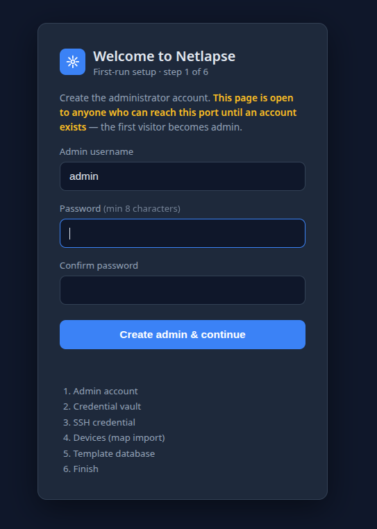
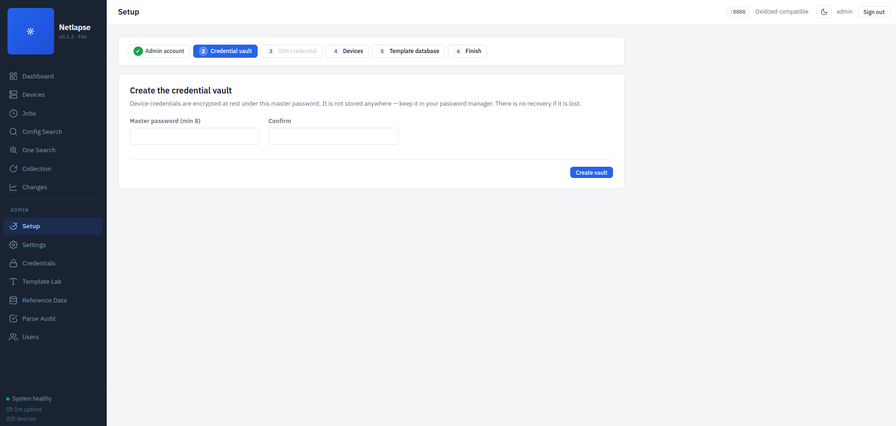
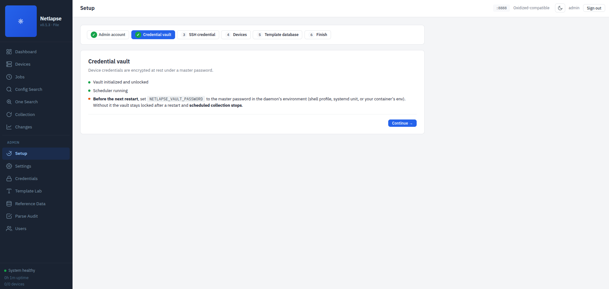
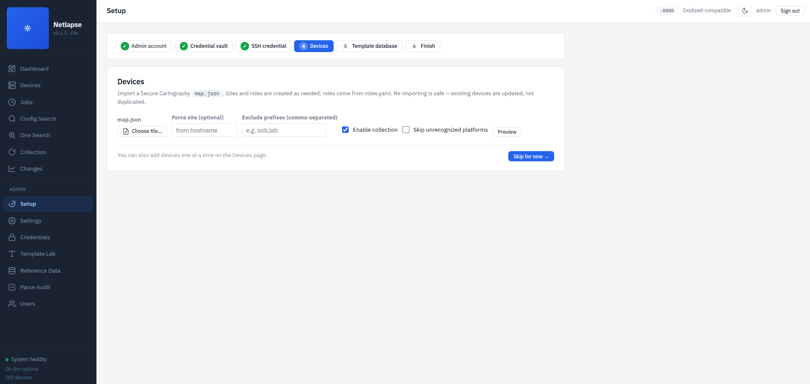
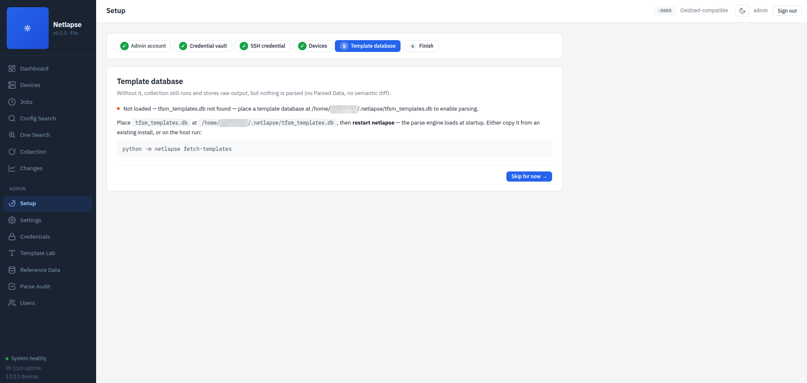
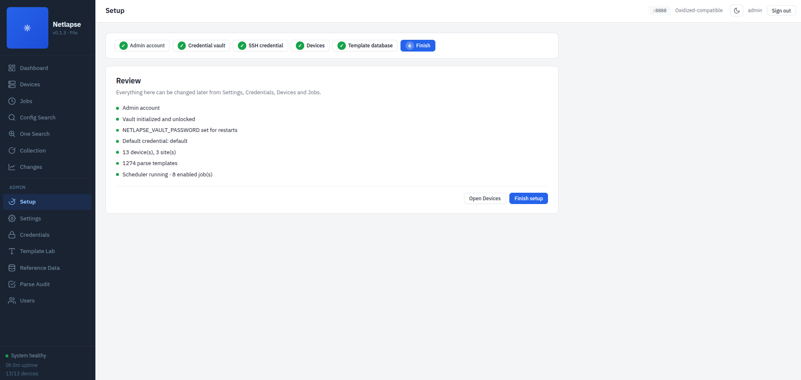

# Getting Started

Netlapse comes up in stages, and several of them fail quietly — the UI serves
fine while nothing is being collected. This guide walks the whole path and
calls out each place where "running" and "collecting" diverge.

Before anything else, one detail that costs people an hour: **use the module
form of the CLI**.

```bash
python -m netlapse <subcommand>
```

The packaged `netlapse` console script maps to the server entry point. It
ignores subcommands and starts the daemon, so `netlapse sync-map map.json`
silently launches a web server instead of importing anything. Every command
below uses `python -m netlapse`.

---

## Fast path: the setup wizard

A fresh install with no user accounts (and no `NETLAPSE_ADMIN_PASSWORD`) starts
in setup mode. Start the daemon and browse to it:

```bash
python -m netlapse serve
```

```
http://127.0.0.1:8888/setup
```

The wizard covers sections 1–4 below from the browser. Each step reports its
state live, so it can be reopened later from **Admin → Setup** and shows what's
already done. Sections 5 onward still apply after the wizard finishes.

### Step 1: Admin account

Until an account exists, the auth gate lets through only the setup page. **The
first visitor to reach the port becomes admin**, so run this step before the
port is reachable by anyone else. Once the account exists, the rest of the
wizard is admin-only and runs inside the app.



### Step 2: Credential vault

Set the master password that encrypts device credentials at rest. There is no
recovery if it's lost.



The wizard initializes the vault, unlocks it for this run, and starts the
scheduler in place. **There is no web unlock.** Before the next restart, put
the same password in the daemon's environment as `NETLAPSE_VAULT_PASSWORD`
(see section 1). Without it the vault stays locked after a restart and
scheduled collection stops.



If `NETLAPSE_VAULT_PASSWORD` is already set when the wizard runs, the password
entered here must match it.

### Step 3: SSH credential

Add at least one SSH credential and mark one as the default.

### Step 4: Devices

Import a [Secure Cartography](https://github.com/scottpeterman/secure_cartography)
`map.json`. Same importer as `sync-map` (section 4): sites and roles are created
as needed, roles come from `roles.yaml`, and re-importing updates existing
devices instead of duplicating them. **Preview** is the dry run. Devices can
also be added one at a time on the Devices page.



### Step 5: Template database

Placing `tfsm_templates.db` stays manual. The step shows the exact path the
daemon expects. Copy the file there or run `python -m netlapse fetch-templates`
on the host, then restart. Without it, collection still runs and stores raw
output, but nothing parses (section 9).



### Step 6: Finish

The review lists what's in place. Everything can be changed later from
Settings, Credentials, Devices and Jobs.



The sections below are the CLI path for each step: headless installs,
scripting, or a reference for what the wizard does.

---

## 1. Initialize the vault

The vault stores device credentials. Initialize it once:

```bash
python -m netlapse vault init
```

You'll be prompted to create and confirm a master password.

For every subsequent run, supply it through the environment:

```bash
export NETLAPSE_VAULT_PASSWORD="your-vault-password"
```

**This is not optional if you want collection.** Without it the vault stays
locked, the scheduler will not start, and the UI comes up looking completely
healthy with collection silently disabled. Startup preflight prints a warning
and pauses for Enter on an interactive terminal — on a systemd unit or in a
container it prints and continues, so the warning scrolls past in the journal.

---

## 2. Set the admin password

The admin password is **not a config file key**. It comes from the
environment:

```bash
export NETLAPSE_ADMIN_PASSWORD="your-admin-password"
```

On a fresh install this creates the `admin` account. If the account already
exists, it resets the password and re-enables the account — the break-glass
path for a locked-out instance.

Unset it after your first login. While it's set, every restart resets the
password, which silently reverts any change made through the UI.

If you start with neither the environment variable nor an existing account,
Netlapse generates a one-time password and logs it **once** at startup. Catch
it there or you'll be resetting.

> Under `provider: ldap` with no local fallback there is no login path that
> validates a local password, so the reset can't get you back in. Set
> `provider: ldap+local` before relying on break-glass.

---

## 3. Add an API token

Edit `~/.netlapse/config.yaml`:

```yaml
auth:
  api_tokens:
    - "your-api-token"
```

Generate something random rather than typing one:

```bash
python -c "import secrets; print(secrets.token_urlsafe(32))"
```

Clients may present it as either header:

```text
Authorization: Bearer your-api-token
X-API-Key: your-api-token
```

**A valid token grants admin.** There are no scoped tokens. Treat it as a root
credential: keep it out of shell history and rotate it if it ends up in a log,
a screenshot, or a pasted terminal session.

Nothing hot-reloads. Restart the daemon after editing `config.yaml`, and
confirm you're editing the file actually in use — `$NETLAPSE_CONFIG` moves the
whole resolution chain, including where definition files are read from.

---

## 4. Import a Secure Cartography map

Existing [Secure Cartography](https://github.com/scottpeterman/secure_cartography)
JSON maps populate Netlapse with discovered devices.

Dry run first — this writes nothing:

```bash
python -m netlapse sync-map map.json --dry-run
```

If the report looks right, import:

```bash
python -m netlapse sync-map map.json
```

Stop the daemon first. Both processes open the same SQLite file and the
importer writes in bulk.

Useful options:

| Option | Effect |
|---|---|
| `--dry-run` | Parse and report, write nothing |
| `--roles PATH` | Hostname→role inference rules |
| `--exclude-prefix PREFIX` | Skip devices by hostname prefix (repeatable) |
| `--no-collection` | Import with collection disabled |
| `--site SLUG` | Force every device to one site |
| `--db PATH` | Database path (default `~/.netlapse/netlapse.db`) |

The import is idempotent — it upserts on device name plus site, so re-running
after each discovery cycle is safe and is the intended workflow.

### Device naming

Devices are stored as `{shortname}.{site}` with the domain stripped:
`core-sw01.site1.lab.example.com` becomes `core-sw01.site1`. If you also
import through any other path, match this convention. A device stored under
its full FQDN and the same device stored short are two different strings, and
you'll get duplicate rows — two SSH sessions per cycle to one box, and two
partial config histories.

### Roles

Roles drive job filters later, so populate them now. Without `--roles`,
Netlapse looks for `roles.yaml` in the definitions directory (alongside
`captures.yaml`), then falls back to built-in naming-convention defaults. A
malformed `roles.yaml` aborts the import rather than mis-roling the fleet.

Roles are the right axis for scoping jobs. Platform can't distinguish a Junos
switch from a Junos router — both are `juniper_junos` — but a role can.

---

## 5. Confirm collection is enabled on devices

The scheduler's target query starts with `WHERE collection_enabled = 1`,
**before any job filter applies**. A device with collection disabled is
invisible to every job no matter how the job is scoped, and the log line is
the same one you'd get from a filter that matched nothing:

```
Job 'config-backup' matched no devices
```

`sync-map` enables collection by default, so this only bites if you imported
with `--no-collection` or created devices through the API. Check the Devices
list — the Collection column should read Enabled.

---

## 6. Review captures and jobs

Two files in `~/.netlapse/` (or wherever `definitions_dir` points):

- **`captures.yaml`** — what to collect. Vendor-neutral intent plus
  per-platform command overrides and the collection interval.
- **`jobs.yaml`** — where each capture runs. Bindings only: no commands, no
  intervals.

Adding a vendor, a command, or a whole capture type is an edit here plus a
restart, not a code change.

### Filters must be nested

Filter keys go under a `filters:` mapping:

```yaml
jobs:
  mac-table:
    capture: mac-table
    name: MAC address table
    filters:
      platform: arista_eos,cisco_ios,cisco_nxos
    enabled: true
```

A filter key at the top level of a binding is **silently dropped** — no error,
no warning, and the job runs fleet-wide. Verify in the UI: the Jobs table has
a FILTERS column, and a filter that took shows as a pill there. A dash means
it didn't.

This matters most for switching captures. `show mac address-table` doesn't
exist on a routing platform, and the device's error response stores as a
structurally complete capture that compares clean against the previous copy
and reports success at every layer. Nothing surfaces it except a diff that
never appears.

### Enabling jobs

`enabled:` in `jobs.yaml` is only the **seed value used the first time a job
is inserted**. After that the live toggle is owned by the database and the UI,
and a sync never overrides it.

The consequence catches everyone: if `jobs.yaml` is ever absent at startup —
renamed, moved, mistyped path — every file-managed job is tombstoned to
disabled. Restoring the file does not re-enable them. Toggle them back on in
the UI.

In the Jobs table, a disabled row renders at reduced opacity, which makes the
whole row look inert. The toggle still works; only the delete button is
genuinely disabled on file-managed jobs.

---

## 7. Size the worker pool before enabling everything

The default is deliberately conservative:

```yaml
scheduler:
  max_workers: 2
```

Two workers will not keep up with a real fleet. Eight captures across a few
hundred devices at 15–30 minute intervals is thousands of collections per
cycle; the scheduler falls permanently behind and `next_run_at` drifts.

Size it from measurement, not a guess:

1. Enable collection on a handful of devices.
2. Turn on one job.
3. Read the DURATION column in the Jobs table for a real per-device number.
4. Compute the rate you need — devices × captures ÷ interval — and set
   `max_workers` accordingly.
5. Restart, then bring up the rest.

Somewhere in the tens is typical for a few hundred devices. Raise it in steps
and watch for authentication throttling on your TACACS or RADIUS servers,
which is usually the real ceiling rather than local CPU.

---

## 8. Start Netlapse

```bash
python -m netlapse serve
```

### Reaching the UI

The default `listen.host` is `0.0.0.0`. That's a bind address, not a
destination:

```
http://127.0.0.1:8888     correct
http://0.0.0.0:8888       Chrome 128+ blocks this
```

The failure mode is a page that renders fine while its WebSocket never
connects, so live status appears frozen while everything else works.

On macOS, prefer `127.0.0.1` over `localhost` for API clients too. `localhost`
resolves to `::1` first, and a daemon bound to `0.0.0.0` is IPv4-only — the v6
attempt is refused outright, surfacing as `[Errno 61] Connection refused`.

---

## 9. Verify the first collection

Structured parsing needs the TextFSM template database (~53 MB), fetched
automatically on first run. If it's missing, collection still works and raw
captures still store — but nothing parses, every capture scores a miss, and
the Parsed Data tab stays empty. Startup preflight warns about this.

To stage it by hand, or for an air-gapped install:

```bash
python -m netlapse fetch-templates          # fetch if missing
python -m netlapse fetch-templates --force  # re-fetch
```

Set `NETLAPSE_SKIP_TEMPLATE_DOWNLOAD` to suppress the automatic fetch.

Once a job has run, open a device and check:

- **Raw Output** — the capture landed
- **Parsed Data** — TextFSM matched, with a template name and match score
- **Snapshots** — versions accumulating
- **Semantic Diff** — available for capture types with a defined record
  identity; configs use the line-aligned config-aware diff instead

A capture whose raw text is byte-identical to the stored copy is skipped
entirely — no rotation, no new version. A device with a static config showing
a single snapshot and no diff is working correctly, not stuck.

---

## Startup checklist

| Symptom | Cause |
|---|---|
| UI loads, nothing ever collects | `NETLAPSE_VAULT_PASSWORD` unset |
| `matched no devices` on every job | `collection_enabled = 0` on the devices |
| `matched no devices` on one job | Filter matched nothing, or the job is disabled |
| Jobs all disabled after a restart | `jobs.yaml` was absent — tombstoned; re-enable in the UI |
| A filter has no effect | Filter key not nested under `filters:` |
| Captures store but never parse | Template DB missing |
| Collection falls behind | `max_workers` too low |
| Page loads, live status frozen | Browsing `0.0.0.0` instead of `127.0.0.1` |
| `[Errno 61] Connection refused` | `localhost` resolving to `::1`; use `127.0.0.1` |
| Config edit had no effect | No hot reload — restart, and check `$NETLAPSE_CONFIG` |