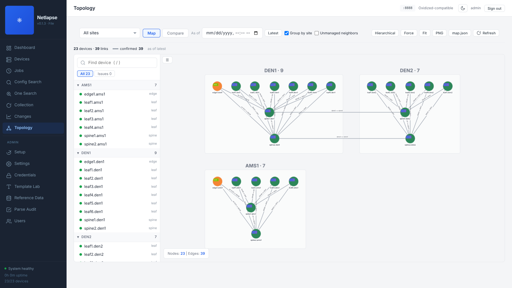
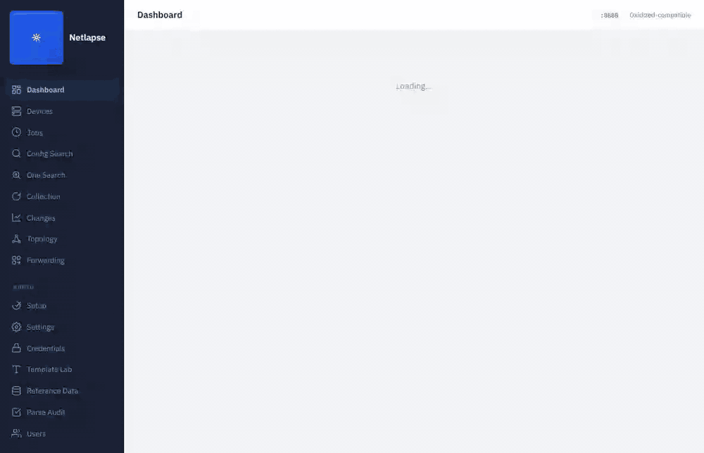
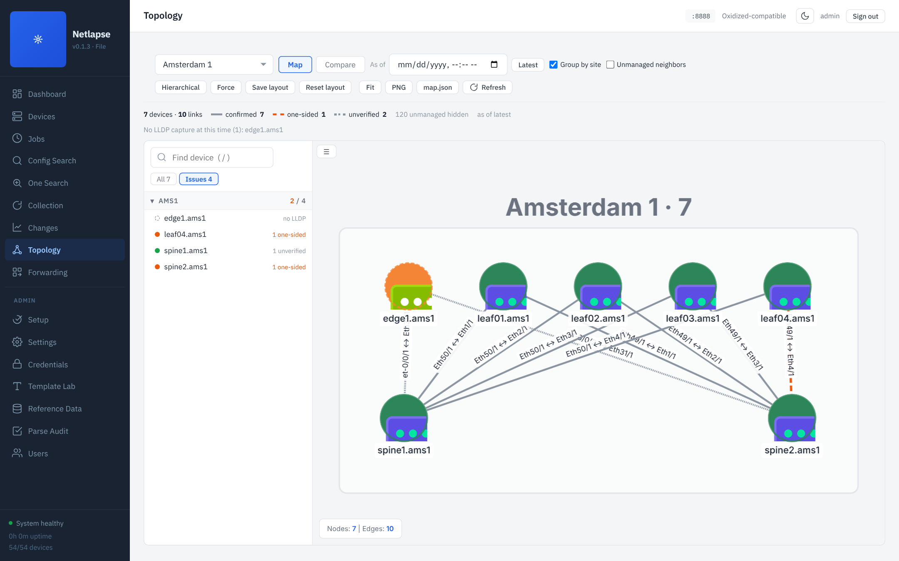
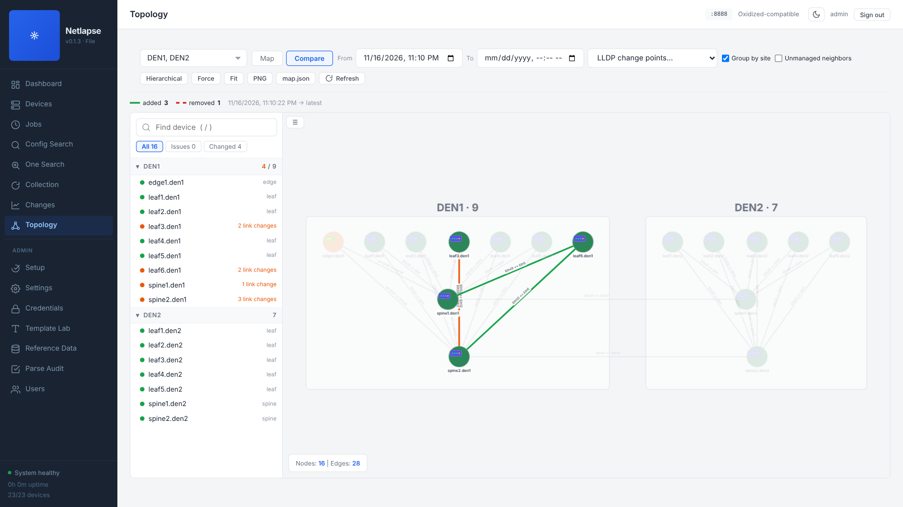
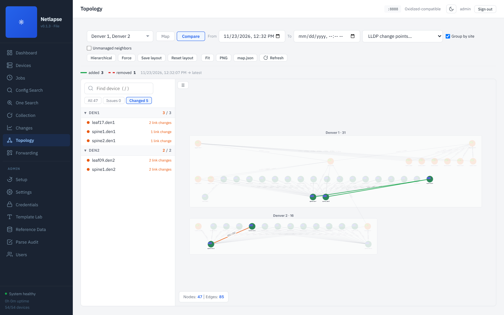
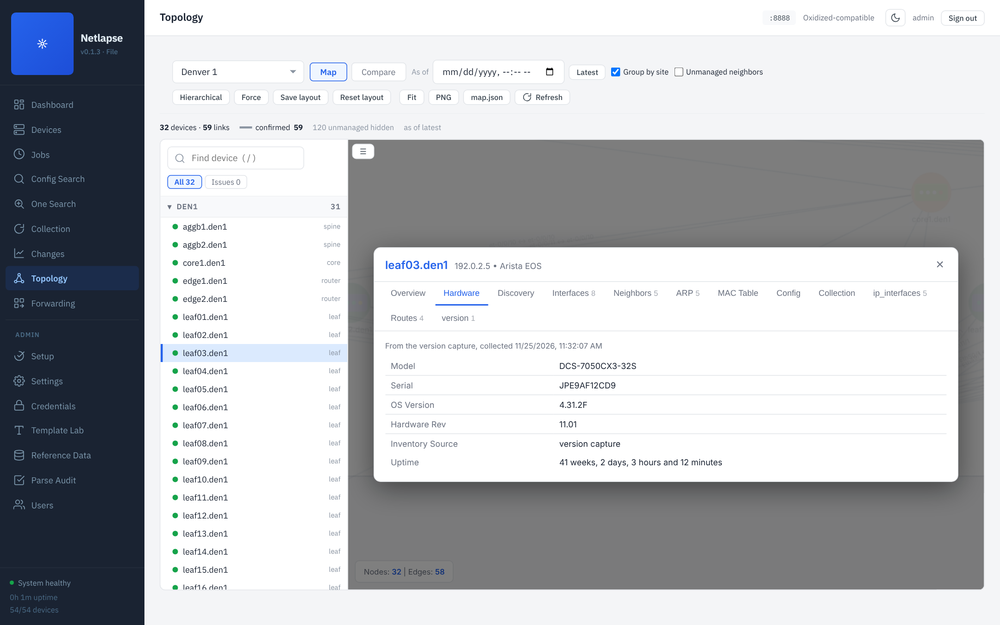
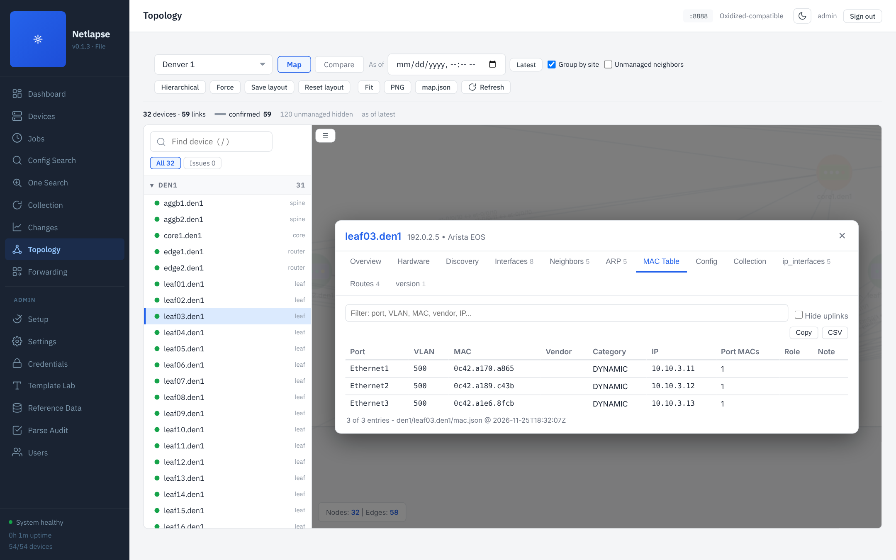
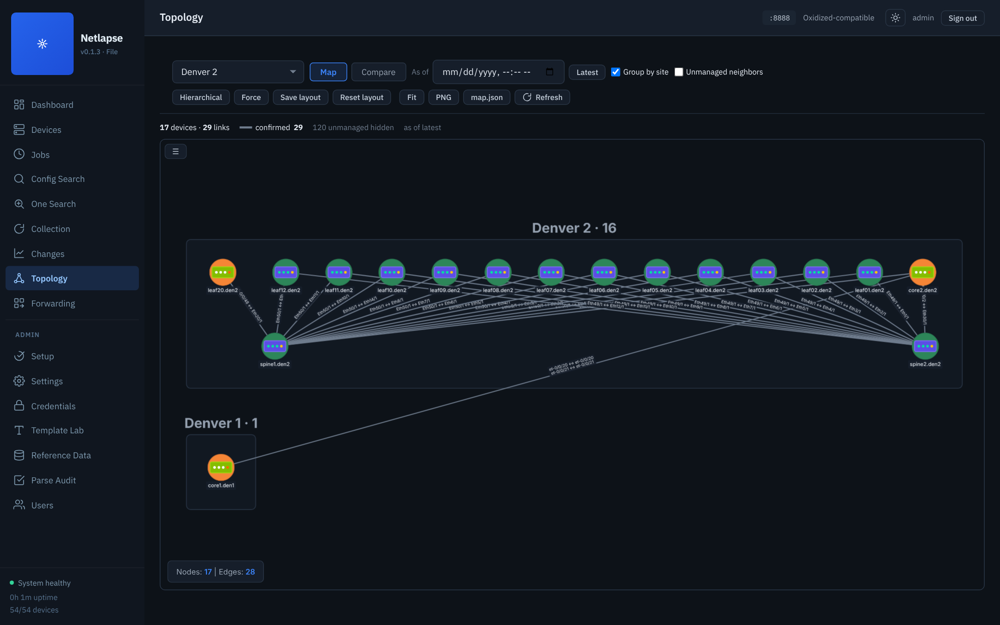

# Topology

The Topology view draws the network from stored `lldp` captures. Nothing is
collected for it: if the LLDP job runs, the map exists.



The screenshots on this page come from the synthetic demo network in `tools/demo_lab.py` (three sites, 54 devices, a few planted link problems and two days of history), regenerated with `tools/screenshots.py`. None of it is a real network.



## How a link is decided

Every LLDP record is one device's claim about one of its ports. Each claim's
neighbor name is matched to a DCIM device (most specific match first, so
`edge1-01.fra1.example.net` finds `edge1-01.fra1` before `edge1-01`; a short
name shared across sites is only accepted when one of them is in the claimer's
site; the management address is the fallback). Then:

| State | Meaning | Drawn |
|---|---|---|
| confirmed | both ends claim each other | solid |
| one-sided | far end is in DCIM and has LLDP data, but doesn't list us | dashed, orange |
| unverified | far end is in DCIM but has no LLDP capture at that time | dotted |
| unmanaged | far end is not in DCIM (servers, carrier gear) | dotted, red "?" node |



A short-name or management-address match that lands in **another site** is
only kept if the far end lists us back. Bare hostnames (`edge01`) and OOB
addresses reused per site otherwise draw links between sites that have no
connectivity; unconfirmed, the neighbor is shown as unmanaged and the edge
panel says what it matched (`short name matches edge01.iad1 in another site;
not confirmed`). A full-name match across sites (`agg1.iad1.example.net`) is
trusted like any other. Duplicate management addresses resolve only within the
claimer's own site.

Port matching is vendor-agnostic (`Ethernet1` = `Et1`, `GigabitEthernet0/1` =
`Gi0/1`, `xe-0/0/1.0` = `xe-0/0/1`). When one end advertises its port as
something other than an interface name (an ifIndex, a description, a MAC), the
link is still confirmed if the other end's port matches. When neither is
usable, a pair of devices that list each other exactly once is confirmed as
that single link. Parallel links with unusable port ids on both ends stay
one-sided rather than being guessed.

Unmanaged neighbors are off by default. On server-facing TORs they outnumber
the network by an order of magnitude; turn them on per view when you want them.

## Sites

The site picker is a multi-select: tick any set of sites and the map rebuilds
once when the picker closes (Apply, Enter, or a click elsewhere; Esc discards).
**only** on a row selects just that site, **All sites** clears the selection.
The selection is part of the URL (`#/topology?site=iad1,iad2`), so a view can
be bookmarked or shared.

## Site grouping

**Group by site** (on by default, remembered per browser) draws each site as
its own box. Hierarchical layout runs per site, so each box is that site's own
picture; sites joined by links are placed side by side and sites with no links
to the rest follow, so an inter-site link reads as a line between two boxes.
Unmanaged neighbors sit in the site of the device that hears them. With sites
selected, the boxes show those sites plus the devices one link away, grouped
by their own site. Force layout uses cytoscape's compound handling.

## Saved layouts

Drag devices (or whole site boxes) where you want them and click **Save
layout**. The positions are stored in the browser's localStorage, one layout
per site selection and per grouping mode, since a grouped map and a flat one
place the same devices differently. The map draws in the saved layout from
then on, and Compare uses the same one, so a diff appears in the arrangement
you know. A device the saved layout doesn't know (new since the save, or only
in a Compare window) is placed next to a neighbor that is in it, and the note
beside the buttons says how many. **Save layout •** means positions have moved
since the last save; Hierarchical, Force, or a drag all set it. **Reset layout**
forgets the saved layout for the current selection and re-runs Hierarchical.

Layouts belong to one browser and one address: the same server opened as
`localhost:8888` and as `10.x.x.x:8888` keeps two separate sets.

## Finding a device

The device list beside the map is grouped by site, with unmanaged neighbors in
their own group. Each row carries a status dot and a short tag (`2 one-sided`,
`no LLDP`, or the role). `/` jumps to the search box from anywhere in the view,
including the canvas; it matches name, platform, role and site. Enter focuses
the first match, Esc clears. Focusing a device from the list dims everything
outside its neighborhood and zooms: to fit the neighborhood when that stays
readable, otherwise (neighbors in another site, a core with dozens of links)
centered on the device at a readable zoom, with the dimming showing where the
far neighbors are. Tapping a node on the canvas selects its row without
moving the view, and tapping the background clears the focus. Double-click a row to open the
device dialog. The **Issues** filter lists devices with one-sided or
unverified links or no LLDP capture; in Compare mode a **Changed** filter
lists devices whose links moved in the window. ☰ hides the list (remembered
per browser).

## Time

- **As of** draws the map from the newest LLDP version at or before that time.
  Git backend: one commit lookup, then the tree at that commit. File backend:
  per device, from `_history/` (bounded by `max_versions`).
- **Compare** builds both ends and returns the union map: added links green,
  removed red dashed, state changes orange, everything untouched faded.
- **LLDP change points** lists collection cycles where LLDP data changed
  (commits less than 120 s apart are one cycle). Picking one compares the
  instant before the cycle against its end.



The **Changed** filter narrows the list to the devices on either end of a change:



## Device dialog

Opening a device fills the dialog from netlapse, read at the map's time:

- **Overview / Hardware** — DCIM (site, role, status, vendor, serial, asset
  tag) plus model, OS version and uptime from a version or inventory capture
  if the device has one. The default job set has none; add a `show version`
  capture to fill them.
- **Interfaces** — the parsed `interfaces` capture (name, description, IP,
  MAC, speed, MTU, link/protocol state).
- **Neighbors** — the LLDP records the map was built from.
- **ARP** — the parsed `arp` capture, one row per entry (IP, MAC, interface,
  age, VRF).
- **MAC Table** — joined to the device's own ARP; a port is marked uplink
  when its LLDP neighbor is in DCIM.
- **Config**, and a raw, filterable tab for every other capture the device
  has (BGP, OSPF, Routes, custom jobs), loaded only when opened.
- **Collection** — every capture with its own collection time, record count,
  template and command, plus DCIM's last collection result.

Captures run on their own intervals, so each tab says which capture it came
from and when that capture was collected.






Every table has **Copy** (aligned plain text with a header rule, for tickets,
chat and MOPs; empty columns dropped) and **CSV**; every raw capture has
**Copy** and **Download**. Both export what is shown, so a filter narrows the
export too. Copy works on plain-http installs (no secure context needed).

Copies over 512 KB (a full config, a route table) ask once: the button turns
into `Copy 2.1 MB?` and a second click within 5 seconds copies. While it runs,
a "Please wait" message covers the dialog, because a multi-megabyte clipboard
write can freeze the page for a while on some machines (clipboard managers,
endpoint agents); Download never touches the clipboard and is instant. Each
copy logs its duration to the browser console (`[netlapse] copied … in N ms`).

The view follows the app theme:



## Platform notes

- **Junos.** The only Junos LLDP template is the brief table, so the packaged
  `captures.yaml` now sends `show lldp neighbors` to `juniper_junos`.
  `captures.yaml` is only seeded on first run; on an existing install add the
  override to `~/.netlapse/captures.yaml` and restart:

  ```yaml
  lldp-neighbors:
    capture_type: lldp
    description: LLDP neighbors detail
    command:
      default: show lldp neighbors detail
      juniper_junos: show lldp neighbors
    interval: 1800
  ```

- **Arista.** Both NTC `arista_eos_show_lldp_neighbors_detail` templates let
  the Link Aggregation TLV's `Port ID : 0` overwrite the neighbor's real port,
  so every Arista neighbor parsed as port `0`. The shipped `tfsm_templates.db`
  carries the fix. For a template DB already in place, apply it and then
  reparse stored `lldp` captures:

  ```
  python tools/fix_arista_lldp_template.py ~/.netlapse/tfsm_templates.db
  ```

## API

```
GET /api/v1/topology            ?site&as_of&unmanaged&status
GET /api/v1/topology/diff       ?from&to&site&unmanaged&status
GET /api/v1/topology/changes    ?days&site
GET /api/v1/topology/artifact   ?device_dir=site/name&kind=<capture_type>&as_of
GET /api/v1/topology/mac        ?device_dir=site/name&as_of
GET /api/v1/topology/node       ?device_dir=site/name&as_of
```

`site` takes one slug or several comma-separated (`site=iad1,iad2`); the
output is those sites plus devices one link away. `as_of`, `from`, `to` take ISO-8601 (offset or `Z`) or `YYYYMMDDTHHMMSSZ`;
omitted means latest. The `map` member of `/topology` is SC2 `map.json` with
two additions per peer (`link_states`, parallel to `connections`) that SC2
ignores, so the export opens in SC2 and imports through
`netlapse_import_map.py`.

## Demo network and screenshots

`tools/demo_lab.py` builds a synthetic network into a scratch directory (DCIM database, file storage with two days of history, definitions and a `config.yaml`). It is the same lab the [Forwarding](README_Forwarding.md) screenshots use. For Topology it plants:

- **Link states.** `edge1.ams1` is in DCIM with no LLDP capture, so its links are unverified; `spine2.ams1` leaves `leaf04.ams1` out of its LLDP table, so that link is one-sided.
- **History.** Two days ago `leaf17.den1` had no LLDP data and `leaf09.den2` was patched to `spine1.den2` Ethernet9/1. Now `leaf17.den1` has both uplinks and `leaf09.den2` sits on Ethernet14/1. That gives Compare three added links, one removed, and an LLDP change point.
- **Unmanaged neighbors.** Three servers running lldpd on every leaf; they show up with **Unmanaged neighbors** ticked.
- **Device dialog data.** Every device has interfaces, ARP, version and config captures; leafs also have a MAC table whose entries join to their ARP. MACs use the Arista, Juniper and Mellanox OUIs.

```
python tools/demo_lab.py --out /tmp/netlapse-demo
NETLAPSE_CONFIG=/tmp/netlapse-demo/config.yaml NETLAPSE_ADMIN_PASSWORD=demo-pass-1 NETLAPSE_SKIP_TEMPLATE_DOWNLOAD=1 python -m netlapse serve
```

`tools/screenshots.py` builds the lab, starts netlapse on it and rewrites `screenshots/topology/` (and `screenshots/forwarding/`) from headless Chromium. It needs Playwright, and ffmpeg for `--gif`. `--fonts-dir` takes a fontsource folder with IBM Plex Sans and Mono when Google Fonts can't be reached.

```
python tools/screenshots.py --only topology --gif
```

`--only tour` records the README's feature tour (`screenshots/netlapse_tour.gif`) from the same lab. For it the lab also carries realistic CLI text for ARP, routes, Junos LLDP and BGP, a server NIC replaced on `leaf03.den1` between the two time points, and BGP transit peers on the edges.
